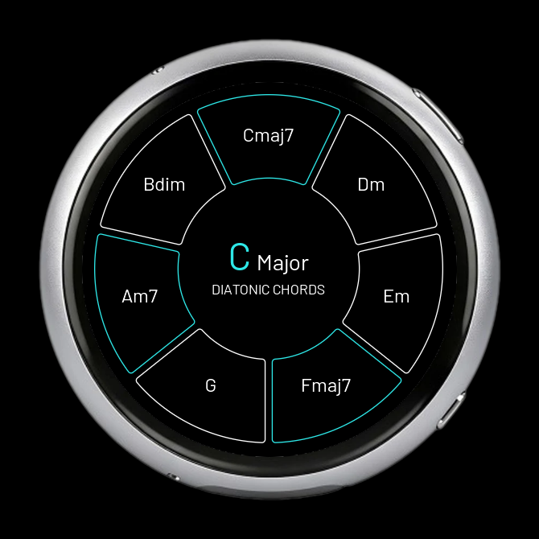
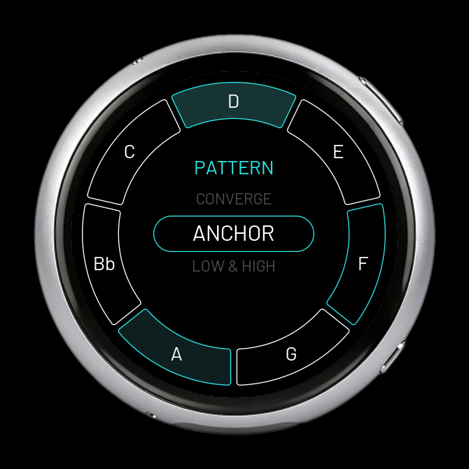
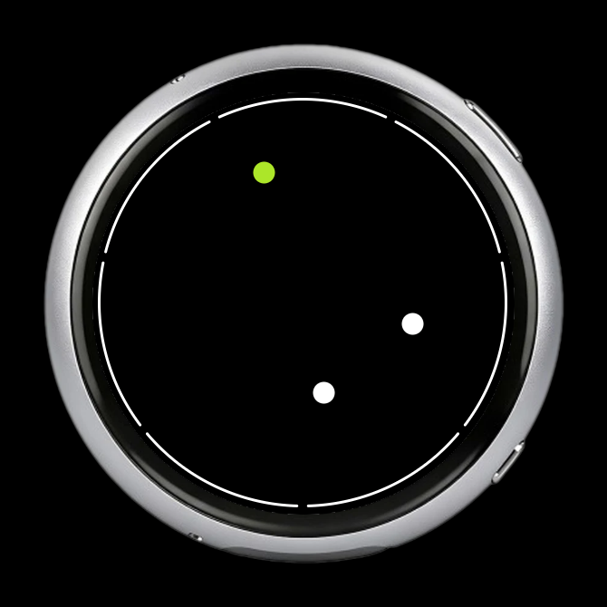
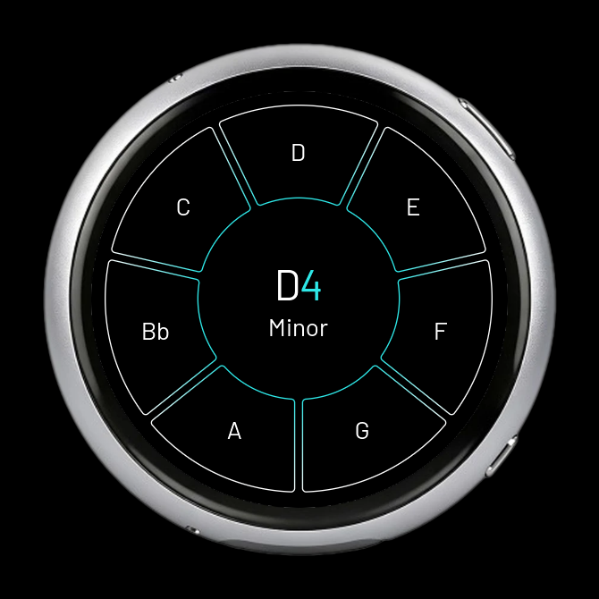
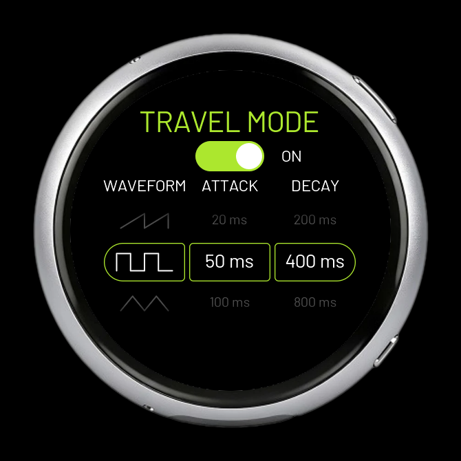
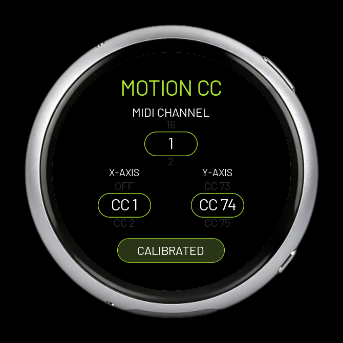

# PROJECT BAX:KI:ZL

## [Download V1.1 for Windows — Simulator + Firmware Installer](https://github.com/AAARRRGGHH/BAX-KI-ZL/releases/download/v1.1/BAX-KI-ZL-Companion-Windows.zip)

## AI transparency and contributions

I do not claim ownership of this project or regard it as my intellectual property. Feel free to modify, adapt, expand, or build upon it under the terms of the **GPL-3.0-or-later** license.

**AAARRRGGHH**, the project initiator, contributed the idea, musical goals, interaction concept, visual direction, feature decisions and extensive practical testing.

**OpenAI Codex** carried out technical implementation under that direction: research, architecture, programming, debugging, automated tests, build tools, simulator and documentation. It was developed with AI assistance, not programmed solely by the project initiator. **KI** stands for *K?nstliche Intelligenz*, the German term for *artificial intelligence (AI)*. Its inclusion in the project name openly acknowledges that collaboration.

Existing libraries, fonts and board drivers retain their authorship and license notices.

**Try it without hardware. If you like it, flash your Waveshare from the same app.**

[English manual (PDF)](docs/BAX-KI-ZL_Manual_EN.pdf) · [Deutsches Handbuch (PDF)](docs/BAX-KI-ZL_Manual_DE.pdf) · [Release notes](docs/RELEASE_V1_1.md)

A pocket-sized musical playground for exploring melodies, harmonies and rhythms without keyboard technique or a background in music theory. The name evokes **Bachkiesel**, a smooth pebble from a stream: small, comfortable to hold and playful.

## Four ways to play

| Mode | Explore |
|---|---|
| **Chords** | Seven diatonic chord pads. Edit chords, shift their octaves, play two together and explore free or tempo-based strumming. |
| **Arpeggiator** | Selected notes across an octave range, ten patterns, timing, swing, probability, gate, block size and ratchet. |
| **Kinetic** | Flick balls around a circular field. Boundary hits become scale notes; size, speed and lifetime shape the music. Optional quantization and clock sync. |
| **Keyboard** | A circular scale keyboard with octave gestures and two-finger playing. |

Also included: a built-in **Travel synth**, **USB/BLE-MIDI**, incoming MIDI clock, **eight named save slots** for all four modes, global or independent scales, persistent settings a selectable UI color and **tilt-to-MIDI CC**.

## Try it on your PC

1. Download the **Windows ZIP** using the link at the top.
2. Extract it and start `BAX-KI-ZL-Companion.exe`.
3. Choose **Run Simulator**. No ESP32, Python installation or development environment is needed.

Click the upper bezel button to cycle modes; hold it for Setup. Right-click opens Kinetic settings. **RESET** appears at the top left only when something can be reset. Hold the lower bezel button for three seconds to return to Companion home. The simulator has local audio.

## Put it on hardware

The firmware targets the **Waveshare ESP32-S3-Touch-AMOLED-1.75C**, aluminium enclosure, **SKU 33691, 32 MB flash / 8 MB PSRAM**. Check the **C** in the model name.

1. Connect a USB data cable and close serial monitors.
2. Choose **Flash Firmware** in Companion.
3. Check and confirm the detected device, then start the flash.
4. Wait for the success message before disconnecting.

Companion installs its prebuilt firmware and verifies the write. It does not compile on your PC or make an automatic firmware backup. Normal updates preserve saved settings. See the manuals for recovery instructions.

[Board information](https://www.waveshare.com/esp32-s3-touch-amoled-1.75c.htm)

## MIDI and Travel

**Travel Mode is ON by default** and plays the internal speaker synth. Switch it OFF to send new notes over MIDI.

- **Windows / Ableton:** USB-MIDI is the tested stable connection. BLE works, but the project's Windows setup showed outgoing timing jitter.
- **Hardware MIDI:** the project initiator successfully tested CME WIDI with a SmplTrek / Eurorack setup. A receiver is optional hardware, not included in the Waveshare.
- **Travel synth:** five waveforms, attack and release for portable play.

The manuals cover playing, saving/loading, connections, clock and power controls. Battery and clock values in screenshots are simulated examples.

The shared default accent is **lime green #ACE72E** across the instrument, Companion, logo, icon and manuals. Existing custom device colors are retained. Companion also adopts the simulator?s confirmed UI color for its logo, buttons and flash dialogs, including after a restart.

## Motion CC

Tilt the pebble to control effects while playing any of the four modes. In
**Setup → MOTION CC**, choose an independent **MIDI CHANNEL** and assign
**X-AXIS** and **Y-AXIS** to **OFF or CC 1–119**. Both axes default to OFF.
Hold it comfortably, tap **CALIBRATE**, then press PWR briefly to save.

The center sends 64; ±45° covers 0–127, with smoothing and a small dead zone.
Assignments and calibration survive shutdown and stay separate from song slots.
Switch **Travel Mode OFF** for external MIDI, then map the CCs at your instrument,
DAW or MIDI-to-CV module. Pitch Bend is not included.

The simulator supports **Ctrl+arrow keys** for virtual tilt and **Ctrl+Home** to
return to level. The color selector also responds more efficiently in V1.1.

## Manuals and source builds

| Language | PDF | Editable source |
|---|---|---|
| English | [V1.1 user manual](docs/BAX-KI-ZL_Manual_EN.pdf) | [Markdown](docs/MANUAL_EN.md) |
| Deutsch | [V1.1 Bedienungsanleitung](docs/BAX-KI-ZL_Manual_DE.pdf) | [Markdown](docs/MANUAL_DE.md) |

[Build from source](docs/BUILD.md) · [Companion details](docs/COMPANION.md)

## License and feedback

Project-owned code uses **GPL-3.0-or-later**. See [LICENSE](LICENSE), [NOTICE](NOTICE) and [third-party notices](THIRD_PARTY_NOTICES.md). Third-party code and font data retain their original licenses.

The repository contains source, tests, generated fonts, required local board/touch modifications and pinned dependency-fetching scripts. It excludes personal logs, device backups and the local toolchain. Binaries are attached under [Releases](https://github.com/AAARRRGGHH/BAX-KI-ZL/releases).

Report the firmware version, device model, connection type and steps to reproduce through [Issues](https://github.com/AAARRRGGHH/BAX-KI-ZL/issues).
