<section class="cover">
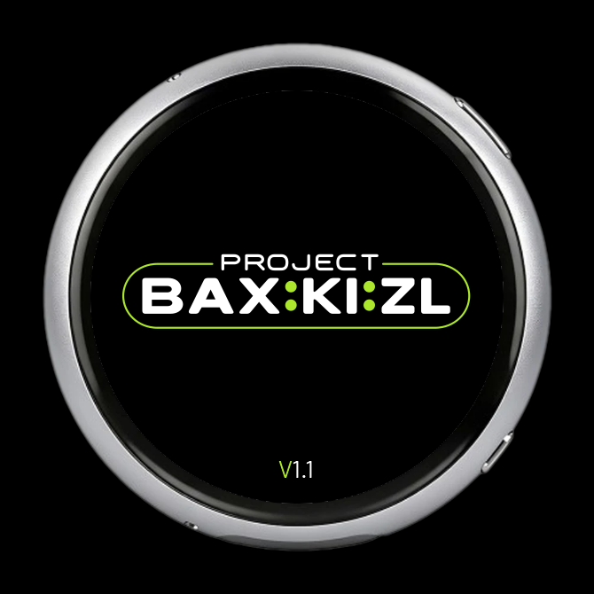

Chords · Arpeggiator · Kinetic · Keyboard

V1.1 – 07/11/2026

Waveshare ESP32-S3-Touch-AMOLED-1.75C · SKU 33691

</section>

Ein kleines Instrument zum Entdecken von Melodien, Harmonien und rhythmischen Mustern – mit internem Reisesynth oder als drahtloser MIDI-Controller für andere Instrumente.

Die Versionsnummer **V1.1** steht unten im Bootscreen: V in UI-Farbe, 1.1 in Weiß. Sie blendet zusammen mit dem Logo aus. Das Doppeltap-Zeitfenster für die mittige Auswahl beträgt 400 ms.

### Transparenz zur Entstehung

BAX:KI:ZL entstand in Zusammenarbeit zwischen dem Projektinitiator und der KI-Programmierassistenz **OpenAI Codex**. Vom Projektinitiator stammen die Idee, die musikalischen Ziele, das Bedienkonzept, die gestalterische Richtung und die Entscheidungen darüber, welche Funktionen zum Instrument gehören. Er hat die Entwicklung durch konkrete Vorgaben, viele Detailkorrekturen und ausgiebige Praxistests am Gerät und mit Ableton gelenkt.

Codex hat die technische Umsetzung erarbeitet: Hardware- und Dokumentationsrecherche, Softwarearchitektur, Quellcode, Fehlersuche, automatisierte Tests, Build-Vorbereitung sowie Simulator und Dokumentation einschließlich dieses Manuals. Die Software wurde damit KI-gestützt entwickelt; sie ist keine vom Projektinitiator allein programmierte Eigenentwicklung. Bestehende Bibliotheken und Boardtreiber bilden die technische Grundlage und behalten ihre jeweiligen Urheber und Lizenzen. Das **KI im Namen** steht auch für diesen offenen Umgang mit der Entstehung.

**Zu den Bildern:** Alle Bildschirmaufnahmen in diesem Manual wurden mit der aktuellen Windows-Simulation erzeugt. Die Gehäuseansicht dient der Orientierung. Die gewählte UI-Farbe ist hier Limegrün. Clock- und Batteriewerte in den Abbildungen sind simulierte Beispiele.

<h2 class="contents-title">Inhalt</h2>

[TOC]

## 1. Schnellstart

### Firmware installieren oder am PC ausprobieren

Die portable **BAX-KI-ZL-Companion.exe** enthält Firmware und Simulator. Eine Installation von Python, ESP-IDF oder Visual Studio ist dafür nicht nötig.

1. **Run Simulator** startet die Simulation direkt im Companion-Fenster, auch ohne angeschlossenes Waveshare.
2. Für das Gerät ein USB-Datenkabel anschließen, serielle Monitore schließen und **Flash Firmware** wählen.
3. Den automatisch gefundenen Anschluss prüfen und **Start Flash** bestätigen. Nur das **Waveshare ESP32-S3-Touch-AMOLED-1.75C, SKU 33691, mit 32 MB Flash** auswählen; ein USB-Bootloader kann auch zu einem anderen ESP32 gehören.
4. USB bis zur Erfolgsbestätigung angeschlossen lassen. Der Flash beginnt nach der Prüfung direkt, **ohne automatische Sicherung**. Gespeicherte Geräteeinstellungen bleiben erhalten.

Die EXE genügt zum Ausführen. Zum Weitergeben ist das ZIP mit Anleitung, Lizenzhinweisen und mitgeliefertem Quellcode vorgesehen. Der Companion besitzt eine englische Oberfläche. Ausführliche Hinweise stehen in Kapitel 11.

### Ohne Computer spielen

1. Das Gerät mit **PWR** einschalten. Den Einschaltknopf vollständig loslassen.
2. Nach dem Logo erscheint **Chords**.
3. Bei einer frischen Konfiguration ist **TRAVEL MODE bereits ON**. Für später gespeicherte Einstellungen: **PWR etwa 0,6 Sekunden halten**, um das Setup zu öffnen.
4. Seitlich zur Seite **TRAVEL MODE** wischen und den Schalter auf **ON** stellen.
5. **PWR erneut kurz drücken**: Die Einstellung wird gespeichert, das Setup schließt sich.
6. Einen Ringbutton berühren und halten. Der interne Lautsprecher spielt den Akkord. Loslassen beendet ihn mit dem eingestellten Ausklang.

Ein kurzer PWR-Druck wechselt weiter zu **Arpeggiator**, **Kinetic**, **Keyboard** und wieder **Chords**.

### Mit Ableton oder einem anderen MIDI-Instrument

Im Setup **TRAVEL MODE OFF** wählen und mit kurzem PWR bestätigen. Für Windows/Ableton per USB verbinden und **BAX:KI:ZL MIDI** auswählen; kabellos erscheint das Gerät als **BAX:KI:ZL**. Die ausführlichen Ableton-Einstellungen stehen in Kapitel 8.

**Wenn nichts zu hören ist:** Zuerst prüfen, ob Travel Mode zur gewünschten Ausgabe passt. ON spielt den internen Synth; OFF sendet MIDI.

### Eine Idee speichern und wieder laden

1. **PWR etwa 0,6 Sekunden halten** und seitlich zu **LOAD / SAVE** wischen.
2. Zum Speichern einen freien Platz **---** wählen und **SAVE** antippen.
3. Mit den acht Buchstabenwheels einen Namen einstellen. Erst **SAVE im Namenseditor** speichert die Idee; **CANCEL** bricht ab.
4. Zum Wiederherstellen den belegten Platz wählen und **LOAD** antippen. Im nächsten Bildschirm den Namen prüfen und erneut **LOAD** drücken.
5. Nach der Aktion gelangst du zurück zur Slot-Auswahl. **PWR kurz drücken**, um das Setup zu schließen und weiterzuspielen.

Es gibt **acht Speicherplätze** für die musikalischen Einstellungen aller vier Modi: Keyboard, Chords, Arpeggiator und Kinetic. Laufende Bälle werden nicht gespeichert. **In den SAVE-/LOAD-/DELETE-Bestätigungsbildschirmen hat PWR keine Funktion** – dort ausschließlich den Aktionsbutton oder CANCEL verwenden. Details stehen in Kapitel 7 unter LOAD / SAVE.

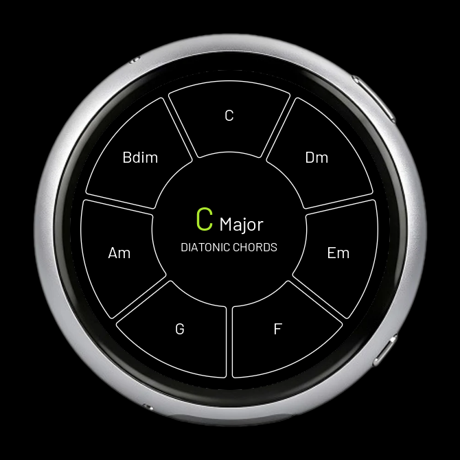
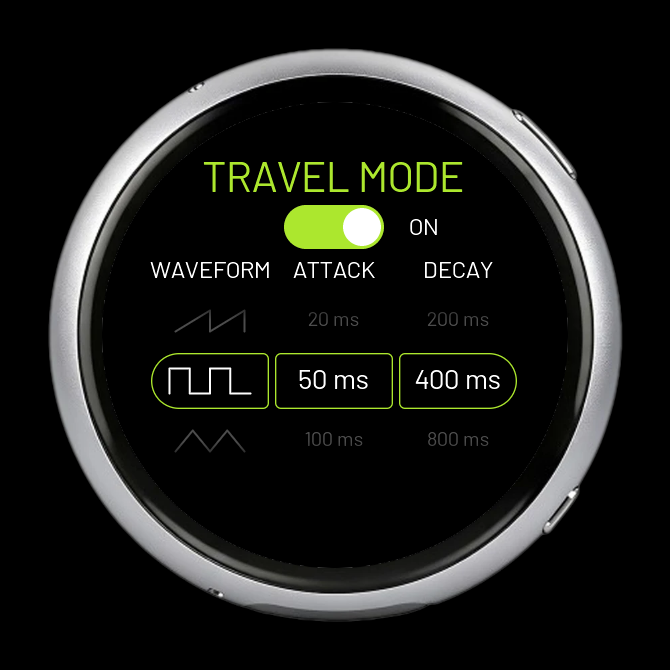

## 2. Tasten, Gesten und Auswahlfelder

Die folgenden Positionen beziehen sich auf die Gehäuseorientierung in den Abbildungen: **PWR oben rechts**, **BOOT unten rechts**.

| Bedienung | Wirkung |
|---|---|
| PWR kurz drücken | Spielmodus wechseln: Chords → Arpeggiator → Kinetic → Keyboard → Chords. Im Setup stattdessen speichern und schließen. |
| PWR ungefähr 0,6 Sekunden halten | Setup öffnen. Der lange Druck schaltet das Gerät nicht aus. |
| BOOT halten | Ausschaltanzeige öffnen. Nach insgesamt drei Sekunden: ohne USB ausschalten, mit USB zum Ladebildschirm wechseln. |
| BOOT vorher loslassen | Ausschalten abbrechen und zur vorherigen Ansicht zurückkehren. Musik läuft während des Akku-Checks weiter. |
| Doppeltap in die Mitte | In Keyboard und Chords die Skalenwahl öffnen. |
| Vertikal über ein Wheel ziehen | Wert auswählen. Nach dem Loslassen rastet das Wheel auf einem Eintrag ein. |
| Horizontal durch eine freie Menüfläche wischen | In Setup und Arpeggiator zur nächsten beziehungsweise vorherigen Seite wechseln. |

Ein einzelner Tap auf die Mitte öffnet die Skalenwahl nicht. Das schützt beim Spielen vor versehentlichem Menüaufruf.

**Wischen zum Seitenwechsel:** Im Arpeggiator am besten oberhalb der Auswahlfelder beginnen. Im Setup eine freie Fläche verwenden; auf der Farbseite durch die freie Mitte wischen. Ein im Scrollwheel begonnener Kontakt bleibt beim Wheel und wechselt keine Seite.

**Bestätigen:** Skalenwahl und Chord-Editor lassen sich mit **SELECT oder einem kurzen PWR-Druck** übernehmen. Das Setup wird mit einem **neuen kurzen PWR-Druck** bestätigt. Das Loslassen des langen Öffnungsdrucks genügt dafür nicht. In den SAVE-/LOAD-/DELETE-Bestätigungsbildschirmen ist PWR dagegen vollständig ohne Funktion, auch bei langem Drücken.

### Reset durch Display-nach-unten-Halten

Im freien Chord-, Arpeggiator- oder Kinetic-Spielbildschirm: Finger vom Display nehmen und das Gerät **eine Sekunde ruhig mit dem Display nach unten halten**. Eine Schräglage von bis zu etwa **40 Grad gegenüber waagerecht mit der Displayseite nach unten** ist erlaubt. Vorzeitiges Aufrichten, stärkere Bewegung oder Berührung bricht den Countdown ab. Diese Geste ersetzt das frühere Schütteln.

| Aktiver Modus | Ergebnis und sichtbare Rückmeldung |
|---|---|
| Chords | Alle sieben Buttons zurück auf Triad und Oktavversatz 0. Alle Umrandungen werden weiß. Key, Skala und globale Strum-Auswahl bleiben erhalten. |
| Arpeggiator | Alle Noten abgewählt; das Arpeggio verstummt. Werte zurück auf Standard: Oktaven 3–5, UP, 1/8 STRAIGHT, 120 BPM, Probability 100 %, BLOCKSIZE OFF, GATE 100 %, RATCHET EVERY OFF / COUNT 2 und Swing 0. Die Mittelseite wechselt zu SCALE. Key, Skala und globale Setup-Werte bleiben erhalten. |
| Kinetic | Alle Bälle und wartenden Noten entfernt. Sämtliche Einstellungen bleiben unverändert, einschließlich Key, Skala, Timing, Oktavumfang, Gate, Lifetime und BPM. |
| Keyboard | Kein Lage-Reset. |

Die Erkennung ist bei Berührung, im Setup, in Auswahlfenstern und beim Ausschalten gesperrt. **Es gibt keine feste Wartezeit nach einem Reset.** Zum erneuten Auslösen das Gerät mindestens **0,1 Sekunden deutlich aufrichten**, dann wieder eine Sekunde nach unten halten. Beim Aufrichten muss die Hand nicht stillstehen; du kannst dabei bereits einen Button bedienen. Bleibt das Display nach unten gerichtet, wird kein weiterer Reset ausgelöst. Auch nach Einschalten oder Spielmoduswechsel das Gerät zunächst normal aufrichten.

## 3. Chords – Stufenakkorde spielen

Der Chord-Modus zeigt **sieben Akkordbuttons**. Die erste Stufe steht oben bei 12 Uhr, die übrigen folgen im Uhrzeigersinn. Die Mitte zeigt Key in UI-Farbe und Skala in Weiß; darunter steht **DIATONIC CHORDS**.

In C Major sind die Grundakkorde **C, Dm, Em, F, G, Am und Bdim**. Du kannst sie frei kombinieren. Es gibt keine vorgeschriebene Akkordfolge.

**Berühren und halten** spielt einen Akkord; **Loslassen** beendet ihn. Im Travel Mode klingt er entsprechend DECAY aus. Die Standardakkorde sind breit gesetzt: drei Akkordtöne plus verdoppelter Grundton, also vier Stimmen. Bei Nonakkorden werden fünf verschiedene Töne verwendet.

Mit zwei Fingern können **zwei vollständige Akkorde gleichzeitig** gespielt werden. Gemeinsame Töne werden beim neuen Anschlag erneut artikuliert; das Loslassen eines Akkords beendet keine Töne, die der andere noch hält. Im Travel Mode können die losgelassenen Stimmen entsprechend DECAY ausklingen.

### Key und Skala wählen

Die Mitte doppelt antippen. Links Grundton und Mode wählen, rechts den Strum-Abstand. **SELECT oder ein kurzer PWR-Druck** übernimmt und speichert die Auswahl.

Bei **GLOBAL SCALE ON** gelten Key und Skala gemeinsam für alle vier Spielmodi. Bei **OFF** bleibt die Auswahl auf Chords beschränkt. Akkordvarianten, Oktavversätze und Strum bleiben beim Skalenwechsel erhalten.

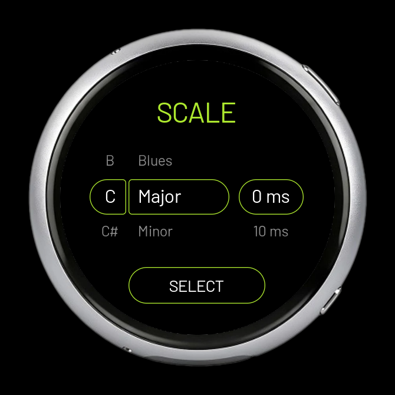
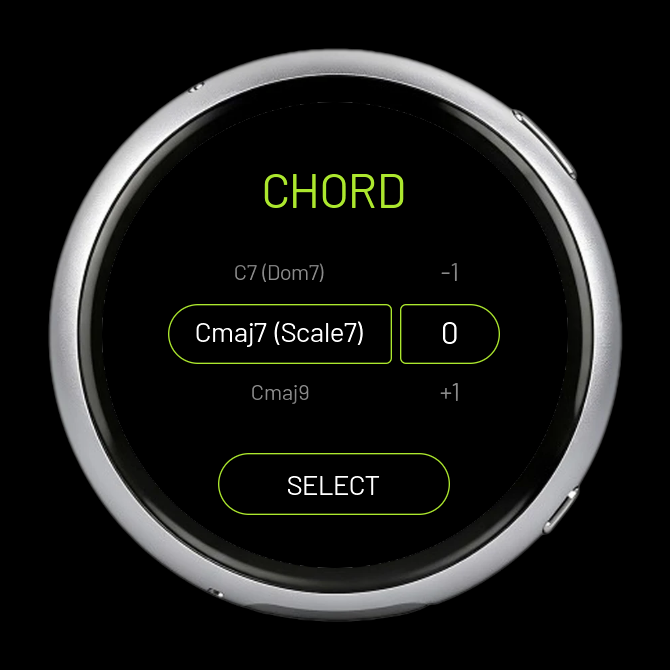

### Einen Akkordbutton verändern

1. Den Finger **in der Mitte aufsetzen**.
2. Zum gewünschten Ringbutton ziehen.
3. Dort loslassen. Der **CHORD**-Editor öffnet sich; diese Geste schlägt keinen Akkord an.
4. Links die Akkordvariante, rechts **OCTAVE −1, 0 oder +1** wählen.
5. Mit **SELECT oder einem kurzen PWR-Druck** bestätigen und speichern.

**Direkt vorhören:** Jede tatsächliche Änderung der Akkordvariante oder des Oktavversatzes spielt den gewählten Entwurf einmal an – im Travel Mode über den Lautsprecher, sonst per MIDI. STRUM wird berücksichtigt; nach dem letzten angeschlagenen Ton bleibt der vollständige Akkord noch etwa **0,6 Sekunden** gehalten und wird dann losgelassen. Im Travel Mode folgt der eingestellte Ausklang. Eine neue Auswahl ersetzt die laufende Vorschau. Beim Öffnen ohne Änderung und beim Weiterdrehen an einem bereits erreichten Oktavanschlag erklingt keine zusätzliche Vorschau.

Beim Verlassen des Editors endet die Vorschau. Ohne Bestätigung durch SELECT oder kurzen PWR-Druck bleibt die gespeicherte Belegung unverändert; die Vorschau selbst speichert nichts.

| Option | Wirkung; Beispiel auf C in C Major |
|---|---|
| Triad | Normaler Stufendreiklang, C. Standard für jeden Button. |
| Maj/Min | Dur/Moll umschalten; C wird Cm. Moll- und verminderte Stufen werden zu Dur. |
| Dom7 | Durakkord mit kleiner Septime, C7. |
| Scale7 | Septime aus der gewählten Skala, hier Cmaj7. Auf Dm entsteht Dm7, auf G entsteht G7. |
| Ninth | Septakkord plus große None, hier Cmaj9. |
| Sus4 | Terz durch Quarte ersetzen, Csus4. |
| Sus2 | Terz durch Sekunde ersetzen, Csus2. |
| Diminished | Verminderter Akkord, Cdim. |
| Augmented | Übermäßiger Akkord, Caug. |

**Weißer Rand:** Triad und Oktavversatz 0. **Rand in UI-Farbe:** Variante oder Oktavversatz verändert. Die Anpassungen bleiben an der jeweiligen Stufe gespeichert, auch wenn du den Key oder die Skala wechselst. Dann werden Akkordnamen und Tonhöhen neu berechnet.

Ein Oktavversatz betrifft nur diesen Button und verschiebt den gesamten Akkord. Die Lage wandert beim Durchspielen des Rings nicht automatisch weiter.

Die Grundakkorde stammen aus der gewählten Skala. Angepasste Varianten können bewusst skalenfremde Töne hinzufügen – beispielsweise durch Dur/Moll-Wechsel, Sus-Akkorde oder die große None.

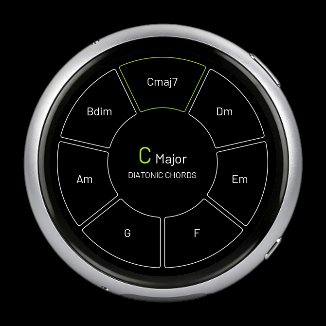

### Strum – Akkordtöne nacheinander anschlagen

Das rechte Wheel in der Chord-Skalenwahl bestimmt den Abstand zwischen den einzelnen Akkordtönen. Gespielt wird **von tief nach hoch**. Der erste Ton kommt sofort; die weiteren folgen im eingestellten Abstand. Die Töne bleiben bis zum Loslassen gehalten. Beim Loslassen werden auch noch ausstehende Töne verworfen.

| MIDI CLOCK | Anzeige und Verhalten |
|---|---|
| OFF | 0–250 ms in 10-ms-Schritten. 0 spielt alle Töne gleichzeitig. Sonst variieren die Abstände dezent um ±10 %. |
| ON | OFF oder musikalische Notenwerte. Das empfangene MIDI-Tempo bestimmt den Abstand, ohne zufällige Timing-Abweichungen. |

Die Clock-Auswahl lautet: **OFF · 1/512 · 1/256 · 1/128 · 1/64 · 1/32T · 1/32 · 1/32D · 1/16T · 1/16 · 1/16D · 1/8T · 1/8 · 1/8D · 1/4T · 1/4 · 1/4D**.

**T** bedeutet Triplet: zwei Drittel des normalen Abstands. **D** bedeutet Dotted: das 1,5-Fache. Pro Notenwert steht deshalb T vor dem normalen Wert und D danach.

Bei 120 BPM hat 1/8 einen Abstand von 250 ms, 1/8T etwa 167 ms und 1/8D 375 ms. Ein vierstimmiger Akkord benötigt drei solche Abstände bis zum letzten Ton.

Millisekunden- und Notenwert-Auswahl werden getrennt gespeichert. Beim Umschalten von MIDI CLOCK kehrt jeweils der vorherige Wert zurück. Tempoänderungen wirken auch während eines laufenden Strums. **Der erste Anschlag wird nicht auf das nächste globale Raster quantisiert.**

Ohne neue Clock wird das zuletzt empfangene Tempo verwendet; vor der ersten Clock gelten vorläufig 120 BPM. MIDI Start/Stop schlägt keine Akkorde an – gespielt wird weiterhin per Touch.

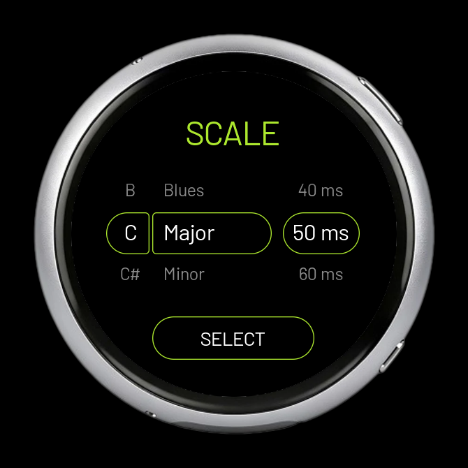
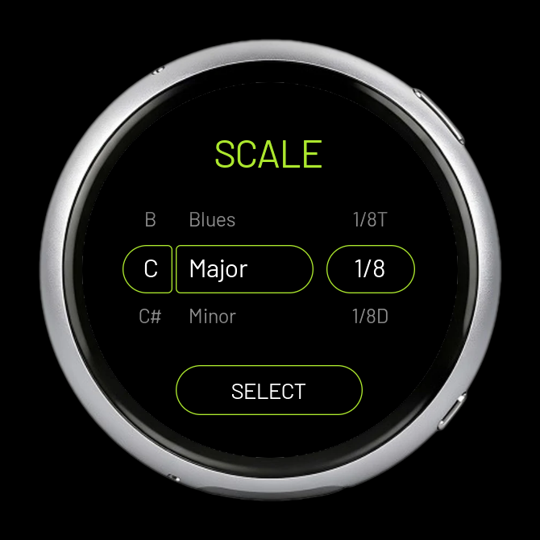

## 4. Keyboard – Melodien finden

Im Keyboard-Modus zeigt jeder Ringbutton **einen Ton der gewählten Skala**. Der Grundton steht oben. Die weiteren Töne folgen aufsteigend im Uhrzeigersinn. Pentatoniken haben fünf, Blues sechs und siebentönige Skalen sieben Buttons.

Eine Note berühren und halten; zum Beenden loslassen. Über den Ring ziehen, um nacheinander Töne anzuspielen. **Zwei Finger können zwei Noten gleichzeitig halten.**

Die Mitte doppelt antippen, um Grundton und Mode auszuwählen. Beide Wheels sind unabhängig. **SELECT oder ein kurzer PWR-Druck** übernimmt und speichert die Auswahl: bei GLOBAL SCALE ON für alle vier Modi, bei OFF nur für Keyboard.

Die leicht verrundeten Notenbuttons unterscheiden sich optisch von den anderen Modi: Nur ihre Konturen haben einen radialen Verlauf von Weiß außen zur UI-Farbe innen; die Flächen bleiben im Ruhezustand schwarz.

### Oktave wechseln

In der **freien Mitte beginnen** und nach oben wischen: eine Oktave höher. Nach unten wischen: eine Oktave tiefer. Die Geste löst selbst keine Ringnote aus.

Bereich **0–8**, Standard **4**. Eine bereits gehaltene Note behält beim Oktavwechsel ihre ursprüngliche Tonhöhe; erst neue Anschläge verwenden die neue Lage. Ein zweiter Finger kann dafür aus der Mitte wischen, während der erste eine Note hält.

Die Skala darf über die gewählte Grundoktave hinausreichen. Töne außerhalb des MIDI-Bereichs 0–127 werden ausgeblendet; an ihrer Stelle bleibt eine Lücke. Im Projekt entspricht **C4 der MIDI-Note 60**. Eine DAW kann dieselbe Note mit einer anderen Oktavnummer beschriften.

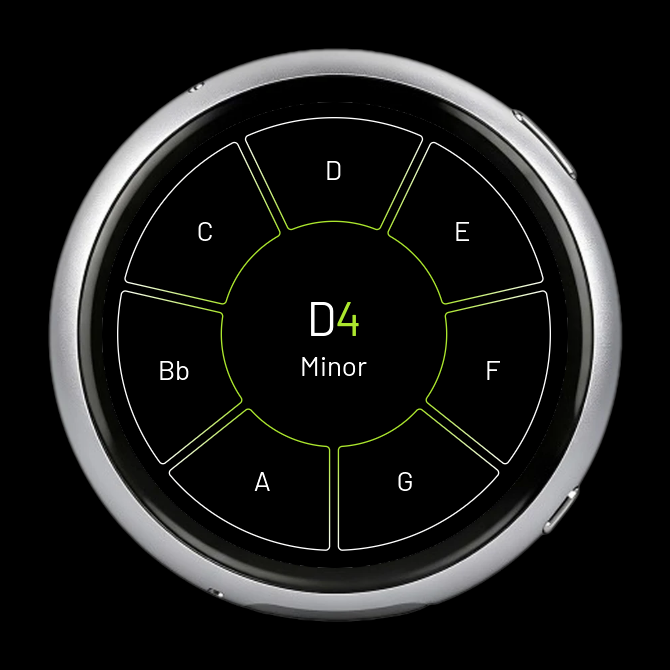
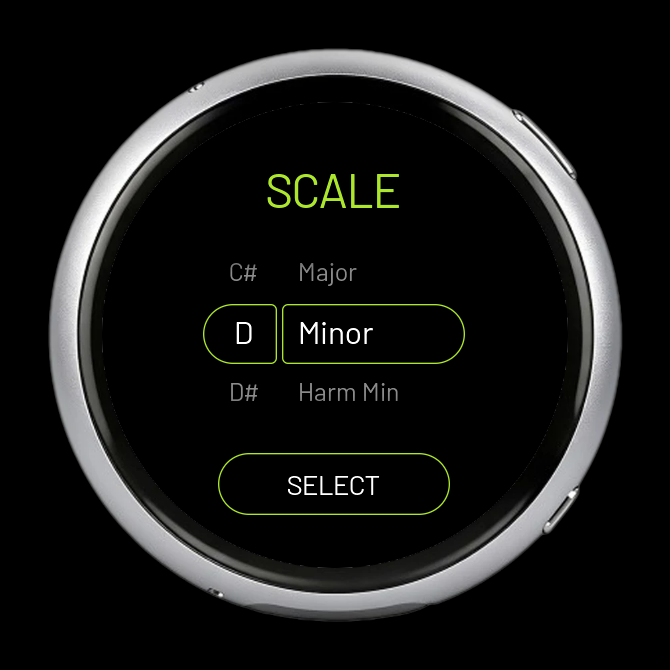

### Verfügbare Skalen

**Major, Natural Minor, Harmonic Minor, Melodic Minor** (aufsteigend), **Dorian, Phrygian, Lydian, Mixolydian, Locrian, Major Pentatonic, Minor Pentatonic und Blues**.

Alle zwölf Skalen sind in allen vier Modi auswählbar. Der Chord-Modus behält immer sieben Buttons: **Major Pentatonic** verwendet die sieben Major-Stufenakkorde, **Minor Pentatonic** die sieben Natural-Minor-Stufenakkorde. Zusätzliche Akkordtöne müssen dabei nicht in der pentatonischen Melodie enthalten sein. **Blues** ist die Moll-Blues-Skala, etwa C–Eb–F–Gb–G–Bb. Die sieben Chord-Buttons verwenden dazu ebenfalls die Natural-Minor-Stufenakkorde, etwa Cm–Ddim–Eb–Fm–Gm–Ab–Bb. Gb bleibt eine melodische Blue Note.

Die Anzeige nutzt internationale Notennamen: **B entspricht deutschem H, Bb deutschem B**. Schwarze Tasten werden passend zur Tonart mit Kreuz- oder B-Schreibweise beschriftet.

## 5. Arpeggiator – Muster aus ausgewählten Noten

Der Arpeggiator hat einen schmaleren Notenring und mehr Platz für die Einstellungen in der Mitte.

**Ringbuttons antippen schaltet Noten ein oder aus.** Aktive Stufen haben einen Rand in UI-Farbe, inaktive einen weißen Rand. Ein gerade gespielter Ton erhält zusätzlich das dezente Flächenfeedback. Der Arpeggiator bildet aus den ausgewählten Stufen in allen gewählten Oktaven seinen Tonvorrat.

Ohne externe Clock startet das Muster, sobald mindestens eine Note ausgewählt ist. Sind alle Noten abgewählt, bleibt es stumm.

### Einstellungsseiten

In der freien Mitte seitlich wischen. Die Reihenfolge ist endlos:

**SCALE → OCTAVES → PATTERN → DIVISOR → BPM → PROBABILITY → BLOCKSIZE → GATE → RATCHET → SWING → SCALE**.

Bei **MIDI CLOCK ON** entfällt die BPM-Seite. Die Einstellungen auf diesen Seiten wirken direkt; ein SELECT-Button ist nicht nötig.

| Seite | Bedienung und Standard |
|---|---|
| SCALE | Key und Mode direkt nebeneinander wählen. Bei GLOBAL SCALE ON werden alle vier Modi synchronisiert, bei OFF nur der Arpeggiator geändert. |
| OCTAVES | Erste und letzte Oktave, beide eingeschlossen. Bereich 0–8, Standard 3–5. Beim Überschreiten der anderen Grenze folgt diese mit. |
| PATTERN | Reihenfolge der Tonhöhen; Standard UP. Alle zehn Patterns stehen unten. |
| DIVISOR | Links 1/1, 1/2, 1/4, 1/8, 1/16 oder 1/32. Rechts STRAIGHT, DOTTED oder TRIPLET. Standard 1/8 STRAIGHT. |
| BPM | 40–300 BPM, Standard 120. Rechts TAP im Viertelnotenabstand antippen. Nur ohne Clock-Empfang sichtbar. |
| PROBABILITY | 100–5 % in 5-%-Schritten, Standard 100 %. Wahrscheinlichkeit, dass ein Notenschritt hörbar gespielt wird. |
| BLOCKSIZE | OFF oder 7, 6, 5, 4, 3, 2. Standard OFF. Nach N Notenschritten folgt ein Pausenschritt. |
| GATE | 100–5 % in 5-%-Schritten, Standard 100 %. Notenlänge als Anteil der Schrittlänge. |
| RATCHET | EVERY: OFF oder 1–16 Schritte. COUNT: 2–4 Anschläge insgesamt. Standard OFF / 2. |
| SWING | 0–50 %, Standard 0. Verlängert und verkürzt abwechselnde Schritte; 0 spielt gerade. |

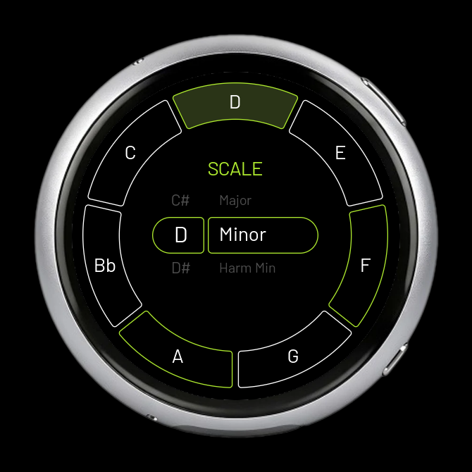
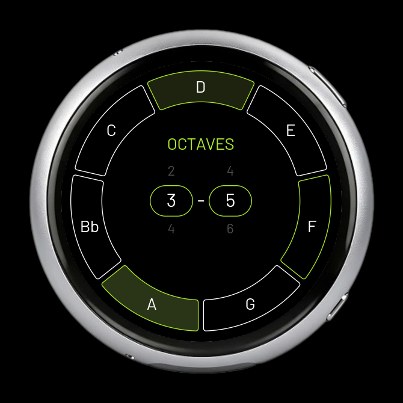

### Patterns

| Pattern | Spielweise |
|---|---|
| UP | Von der tiefsten zur höchsten Note, dann wieder von unten. |
| DOWN | Von oben nach unten. |
| UP/DOWN | Auf und ab, ohne doppelt gespielte Endnoten. |
| RANDOM | Zufällige Note aus dem Tonvorrat; Wiederholungen sind möglich. |
| SHUFFLE | Alle Noten in gemischter Reihenfolge, dann neu mischen. |
| CONVERGE | Tiefste, höchste, zweittiefste, zweithöchste und so weiter nach innen. |
| ANCHOR | Abwechselnd die tiefste Note und eine zufällige andere Note. |
| LOW & HIGH | Tiefste Note, derselbe Ton in der höchsten gewählten Oktave, dann eine zufällige andere Tonhöhe. Diese Dreierfigur wiederholt sich. |
| GRAVITY | Zufälliger Startton ab der dritten Position, ungefähr auf halbem Weg nach unten ein Zwischenton, dann der tiefste Ton. Beispielsweise 6–3–1 oder 7–4–1. |
| PIVOT | Ein Tonpaar verändert sich schrittweise: AB, AC, DC, DE, FE. Nach jedem Paar wird abwechselnd nur einer der beiden Töne ersetzt. |

**ANCHOR-Tipp:** Während das Muster läuft, tiefe Noten hinzufügen oder wegnehmen. So verändert sich der Anker und du kannst Melodielinien in das Muster hineinspielen.

**LOW & HIGH:** HIGH ist derselbe Ton in der höchsten gewählten Oktave, nicht die höchste Note des gesamten Vorrats. Bei C3 und C5 als Ankern ist C4 für den Zufallsschritt erlaubt; nur C3 und C5 sind ausgeschlossen. Fehlt eine dritte Tonhöhe, bleibt dieser Schritt stumm. Bei nur einer Oktave stimmen LOW und HIGH überein. Ein HIGH oberhalb des MIDI-Umfangs bleibt ebenfalls stumm.

GRAVITY wiederholt bei zwei verfügbaren Tönen die Figur 2–1–1, bei einem Ton 1–1–1. PIVOT behält bei zwei Tönen sein Paar bei und wiederholt bei einem Ton diesen. Diese Patterns enthalten keine festen Pausen; dafür stehen BLOCKSIZE und PROBABILITY zur Verfügung. Alte Speicherstände mit den entfernten Patterns MIRROR oder OCTAVE ECHO werden mit UP geladen.

Das Hinzufügen oder Entfernen von Noten und das Ändern des Oktavbereichs setzen die laufende Folge nicht auf ihren Anfang zurück. Ein Patternwechsel wird am nächsten regulären Schritt übernommen und schneidet die laufende Note nicht mitten im Klang ab.

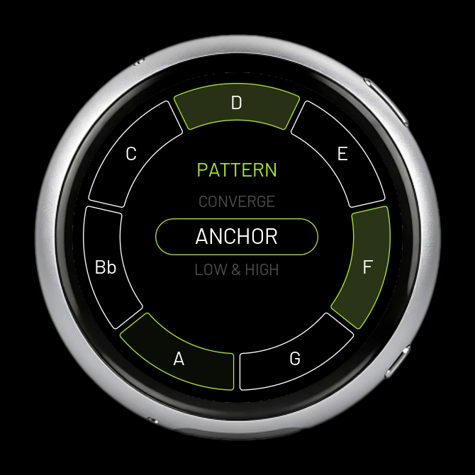
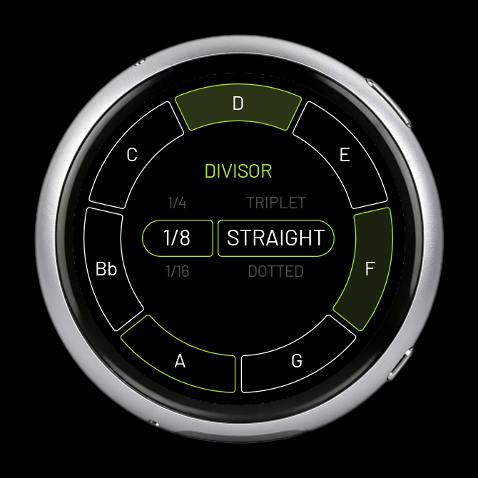

### Tempo, Pausen und Swing

**TAP:** Mehrmals im gewünschten Viertelnotenabstand tippen. Sobald ein Tempo erkannt wird, springt das BPM-Wheel auf diesen Wert. TAP ändert das Tempo, ohne die Folge neu zu starten oder die gerade gespielte Note abzuschneiden.

**Probability:** Bei 100 % spielt jeder freigegebene Schritt. Kleinere Werte erzeugen zufällige Lücken. Der kleinste Wert ist 5 %. Zum vollständigen Stummschalten alle Noten abwählen oder den Spielmodus wechseln.

**BLOCKSIZE:** Bei 2 entsteht `Ton – Ton – Pause`, bei 4 `Ton – Ton – Ton – Ton – Pause`. Die Pause hat die Dauer eines normalen Schritts. Das Tonhöhenmuster schreitet auch durch die Pause weiter. Die Blockzählung zählt Rasterpositionen; zusätzlich durch Probability ausgelassene Töne verschieben sie nicht. Eine Änderung beginnt die Blockzählung am nächsten regulären Schritt neu.

**Swing:** Die Folge bleibt im mittleren Tempo, aber aufeinanderfolgende Schritte werden lang und kurz. Als Beispiel bei 120 BPM und 1/8: mit Swing 0 dauern beide Schritte 250 ms; bei Swing 50 dauern sie 375 ms und 125 ms. Diese Anzeige ist eine Intensität von 0 bis 50, keine konventionelle Tempo-Prozentanzeige.

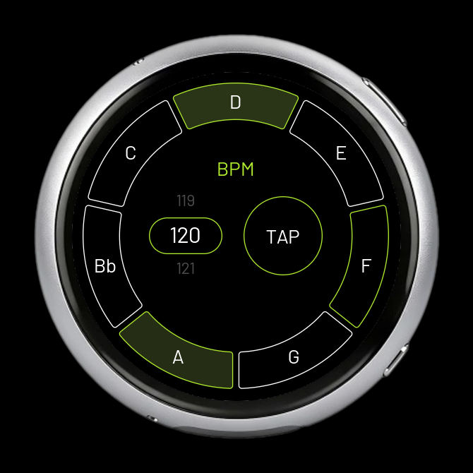
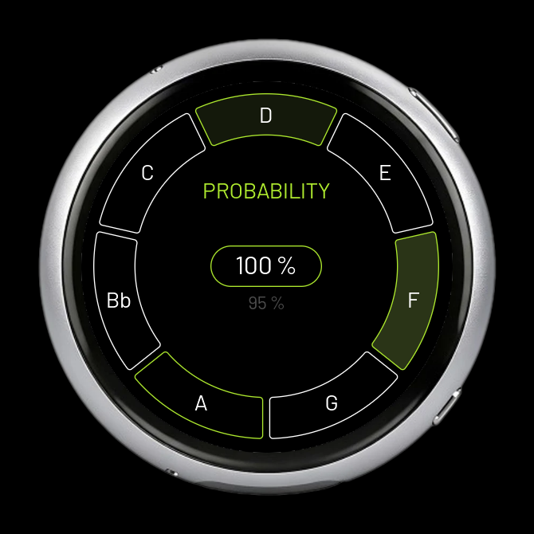

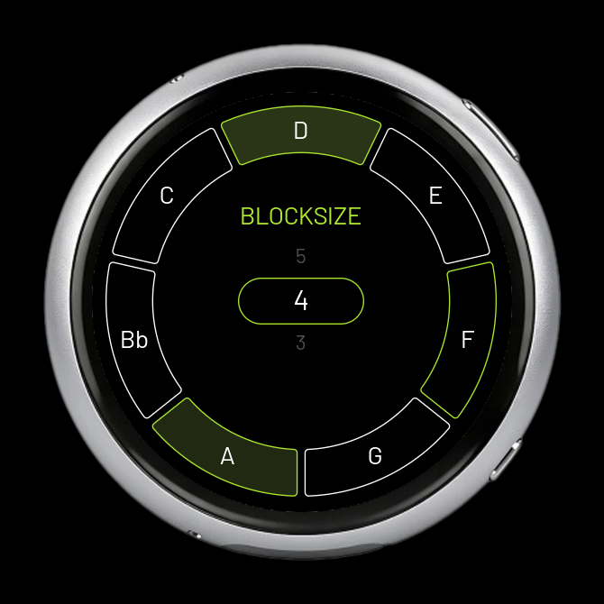
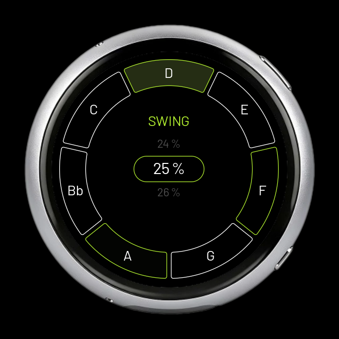

### Gate und Ratchet

**GATE** bestimmt, wie lange eine Note innerhalb ihres Schritts gehalten wird. Bei 120 BPM und 1/8 dauert ein gerader Schritt 250 ms: GATE 100 % hält bis zum nächsten Schritt, GATE 50 % für 125 ms. Der Ausklang des Instruments beziehungsweise DECAY im Travel Mode kann darüber hinaus hörbar bleiben. Swing, Dotted/Triplet und externe Clock werden bei der Schrittlänge berücksichtigt. Eine Änderung gilt für die nächste Note und schneidet die laufende nicht ab.

**RATCHET** schlägt dieselbe Note innerhalb eines Schritts mehrfach an. Mit **EVERY 4 / COUNT 3** wird jeder vierte Schritt in drei gleich lange Anschläge geteilt. Das Tonhöhenpattern geht erst beim nächsten regulären Schritt weiter. EVERY 1 betrifft jeden Schritt; OFF deaktiviert Ratchet. Pausenschritte durch BLOCKSIZE oder Probability bleiben stumm, zählen aber im Raster mit.

Beim Einschalten von Ratchet wird der bisherige Gate-Wert gemerkt. Liegt er über 50 %, wird er automatisch auf **50 %** abgesenkt, damit die Wiederholungen deutlicher hörbar sind. Beim Ausschalten kehrt der zuvor gemerkte Gate-Wert zurück. Änderungen an EVERY, COUNT oder GATE bei bereits aktivem Ratchet ersetzen diesen Rückkehrwert nicht. Er wird auch beim Speichern und Laden berücksichtigt.

Bei Ratchet bezieht sich GATE auf jeden einzelnen Teilanschlag. Lange Ausklangzeiten können die Wiederholungen verschmelzen lassen. Stop, Moduswechsel und Clock-Verlust beenden auch noch ausstehende Wiederholungen.

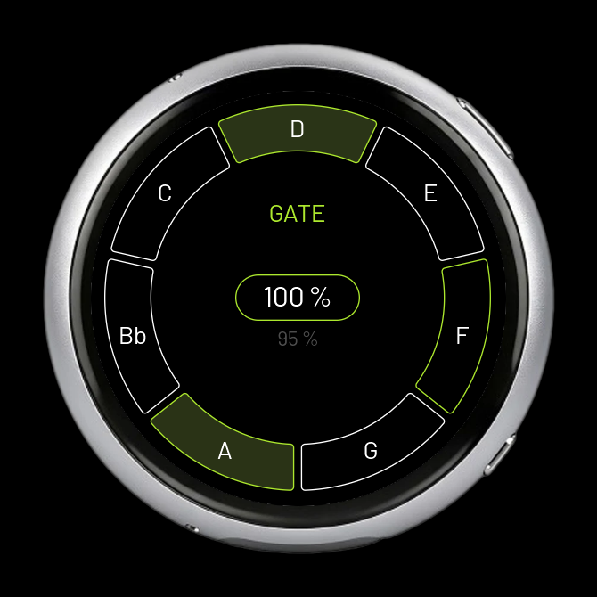
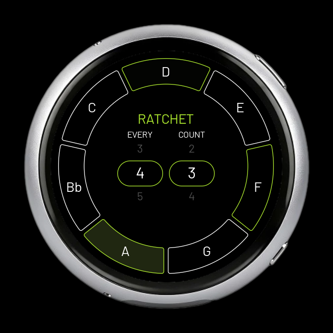

### Externe MIDI-Clock

Im Setup auf **MIDI → MIDI CLOCK ON** wechseln und mit kurzem PWR bestätigen. Anschließend den Arpeggiator auswählen, Noten aktivieren und am Taktgeber starten.

- **MIDI Start:** Folge neu beginnen.
- **MIDI Stop:** laufende Note beenden und anhalten; die Notenauswahl bleibt bestehen.
- **MIDI Continue:** fortsetzen, ohne einen vollständigen Neustart anzufordern.
- Ohne Clock über mehr als etwa 0,5 Sekunden stoppt die Ausgabe. Zum erneuten Starten einen neuen externen Start senden.

Die aktuelle Clock-BPM-Anzeige findest du im MIDI-Setup. Ohne gültige Messung steht dort **-- BPM**. Clock und Transport sind unabhängig vom MIDI-Notenkanal.

## 6. Kinetic – Bewegung wird Musik

Kinetic, bisher „Bounce“, ist ein interaktives Musikspielzeug: Du schleuderst Bälle durch das runde Spielfeld. Jeder Treffer am äußeren Notenring spielt einen Ton der gewählten Skala. Du kannst zuhören, einen Ball erneut anschubsen oder weitere Impulse hineinwerfen.

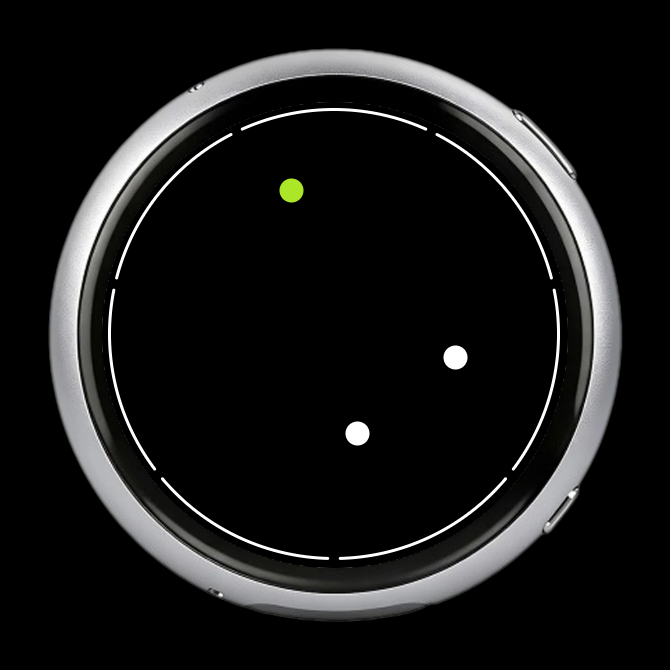
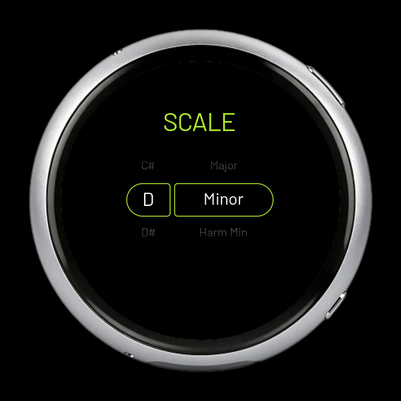

### Bälle erzeugen, greifen und schleudern

Eine freie Stelle berühren, den Finger bewegen und loslassen. Ein schneller Wisch erzeugt einen schnellen Ball; ein ruhiges Loslassen gibt keinen zusätzlichen Schubs. Es können **sieben Bälle manuell** erzeugt werden.

Bälle sind abwechselnd weiß oder in UI-Farbe. Sie prallen am Rand und aneinander ab. Mit der Zeit verlieren sie Energie: Sie werden kleiner und langsamer, ihre Velocity sinkt innerhalb der Kurve **40–110**. Große Bälle spielen tiefere, kleine höhere Oktaven im gewählten Bereich. Am Lebensende blenden sie weich über ungefähr 1,2 Sekunden aus.

Zum Wiederaufladen einen Ball greifen: Sein Energie- und Lebenszeitverlauf wird zurückgesetzt. Innerhalb von etwa **120 ms** gleitet er von seiner bisherigen Position zum Finger und wächst gleichzeitig wieder auf volle Größe. Das funktioniert auch während des Ausblendens. Der Aufnahmebereich bleibt für kleine Bälle großzügig; liegen mehrere darin, wird der nächstgelegene freie Ball gegriffen. Danach kannst du ihn neu schleudern. Die im Test gewählte Wurfkurve 11 ist fest eingestellt; das zeitweilige Kurvenmenü entfällt.

Die weißen Randsegmente zeigen die Notenbereiche der Skala. Ein Treffer lässt das betreffende Segment kurz in UI-Farbe aufleuchten. Der Ring dreht sich nicht. Siebenstufige Skalen haben sieben Segmente, Pentatonik fünf und Blues sechs.

### Einstellungen öffnen

Ein **kurzer Zwei-Finger-Tap** öffnet das Menü. Beide Finger nahezu gleichzeitig aufsetzen und ohne Wischbewegung wieder lösen. Im Windows-Simulator genügt alternativ ein Rechtsklick. Seitliches Wischen wechselt endlos zwischen den Menüseiten. Ein kurzer **PWR-Druck** schließt das Menü; ein weiterer wechselt zum Keyboard. Während des Kinetic-Menüs laufen Bälle und Musik weiter. Das globale Setup pausiert den Modus dagegen.

Änderungen gelten sofort und werden automatisch gespeichert. Es gibt keinen zusätzlichen SELECT-Button. Bereits gespeicherte Werte bleiben bei Firmware-Updates erhalten; die folgenden Standards gelten bei einer frischen Konfiguration. Der Kinetic-Reset verändert sie nicht.

| Seite | Bedienung | Standard |
|---|---|---|
| SCALE | Grundton und Mode. GLOBAL SCALE ON synchronisiert alle vier Modi. | Gemeinsame Skala; bei eigener Auswahl B Minor. |
| OCTAVES | Untere und obere Grundoktave getrennt wählen, Bereich 0–8. | 3–5 |
| BPM | 40–300 per Wheel oder TAP. Bei MIDI CLOCK ON ausgeblendet. | 120 |
| TIMING | QUANTIZE-Schalter, Divisor sowie STRAIGHT / DOTTED / TRIPLET. | ON, **1/8 STRAIGHT** |
| GATE | Notenlänge als Anteil eines Schritts, 100–5 % in 5-%-Schritten. | 50 % |
| LIFETIME | Abkling-Zeitkonstante in Sekunden, 10–90 in 5er-Schritten. | **15 s** |

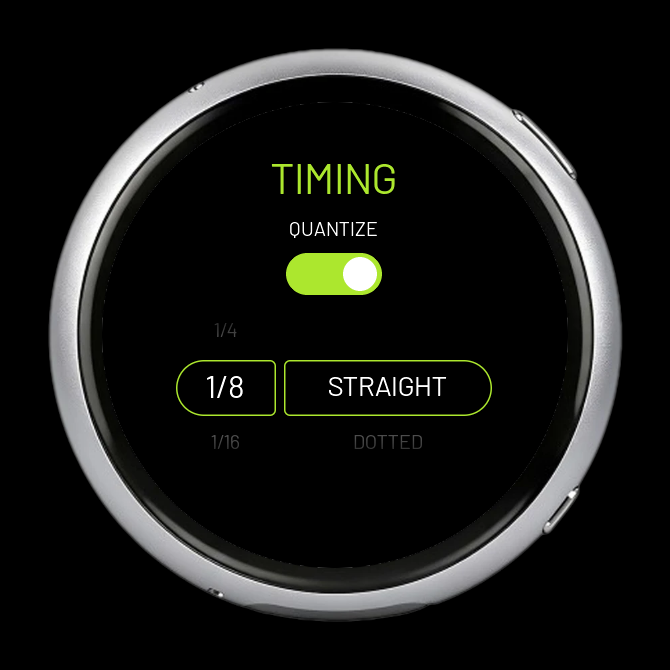
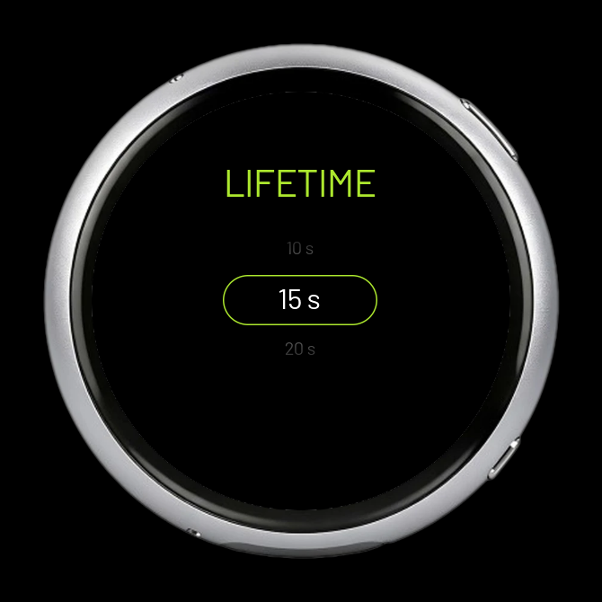

**LIFETIME ist keine feste Stoppuhr:** Der Wert steuert den Energieabbau. Ein ungestörter Ball bleibt normalerweise länger als den angezeigten Wert sichtbar. Erneutes Aufnehmen lädt den Ball wieder auf und verändert seinen weiteren Verlauf.

### Raster, Gate und Akkorde

QUANTIZE ON sammelt Randtreffer bis zum nächsten gewählten Rasterpunkt. Bei **120 BPM und 1/8 STRAIGHT** dauert ein Schritt **250 ms**; Gate 50 % hält den MIDI-Ton etwa **125 ms**, Gate 100 % einen vollen Schritt. Der Ausklang des empfangenden Instruments oder des Travel-Synths kommt anschließend hinzu. QUANTIZE OFF spielt Treffer unmittelbar; der gewählte Schrittwert bestimmt weiterhin die Gate-Dauer.

Treffen verschiedene Tonklassen auf denselben Rasterpunkt, sucht Kinetic einen zum Trefferbild passenden **Dur- oder Moll-Dreiklang aus der aktiven Skala**. Soweit die Oktavlage Platz bietet, ergänzt es den Grundton in einer weiteren Oktave: vier Stimmen, keine Septakkorde. Gleiche Tonklassen dürfen als Unisono oder Oktaven stehenbleiben. Deshalb ist das gehörte Ergebnis nicht immer eine unveränderte Wiedergabe aller einzelnen Treffer.

MIDI CLOCK ON verwendet bei laufendem externem Transport dessen Clock für das Raster. Bei Stop oder Clock-Ausfall spielt Kinetic intern weiter: mit dem zuletzt gemessenen Tempo, vor der ersten Clock mit dem gespeicherten BPM-Wert. Beim nächsten Start/Continue und eintreffender Clock wird wieder extern synchronisiert. Du musst den Empfang nicht ständig ein- und ausschalten. Bei Zeitquellenwechseln werden wartende Treffer verworfen; bereits klingende Noten erhalten ihr reguläres Note Off.

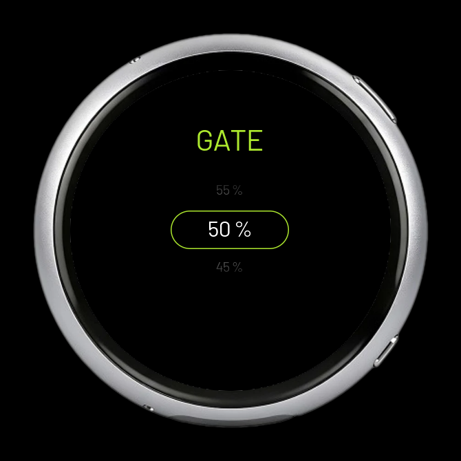

Ballkollisionen bleiben rein physikalisch. Die experimentelle Ballspaltung und ihr Schalter sind in V1.0 entfernt. Noten entstehen bei Randtreffern.

### Reset und Speicherung

Die bekannte Geste gilt auch hier: im freien Spielbildschirm ohne Berührung **eine Sekunde mit dem Display nach unten halten**. Alle Bälle und wartenden Noten verschwinden; sämtliche Kinetic-Einstellungen bleiben unverändert. Im Simulator löst **Strg + Umschalt + R** denselben Reset aus.

Kinetic speichert seine Einstellungen beim Ändern, aber **keine Bälle oder laufenden Ballbahnen**. Nach einem Neustart beginnt das Spielfeld leer. Die acht LOAD-/SAVE-Plätze enthalten jetzt auch alle Kinetic-Einstellungen; laufende Bälle bleiben ausgenommen. Es gibt kein Panning: MIDI wird weiterhin auf dem global ausgewählten Kanal ausgegeben.

## 7. Setup und Travel-Synth

**PWR lange halten**, um das Setup zu öffnen. Die Seiten laufen zyklisch: **MIDI → MOTION CC → UI COLOR → TRAVEL MODE → GLOBAL SCALE → LOAD / SAVE → MIDI**. Während des Betriebs öffnet sich jeweils die zuletzt benutzte Seite. Nach einem Neustart beginnt das Setup bei MIDI.

Änderungen können über mehrere Seiten hinweg vorgenommen werden. **Ein neuer kurzer PWR-Druck bestätigt und speichert alle Setup-Werte** und führt zum vorherigen Spielmodus zurück.

### MIDI

Oben wählt **AUTO / USB / BLE** den Ausgabeweg. AUTO bevorzugt USB, sobald eine USB-MIDI-Verbindung verfügbar ist. BLE bleibt auch bei angeschlossenem Kabel als eigener Weg auswählbar.

Links den **CHANNEL 1–16** wählen; Standard ist 1. Rechts **MIDI CLOCK** ein- oder ausschalten; Standard ist OFF. Der MIDI-Kanal gilt für alle Spielmodi. Keyboard, Chords und Arpeggiator senden Velocity 100; Kinetic verwendet abhängig von der Ballenergie 40–110.

Bei MIDI CLOCK ON steht unten das gemessene externe Tempo: Zahl weiß, **BPM** in UI-Farbe. Die Anzeige benötigt eine vollständige Messung und läuft auch außerhalb des Arpeggiators. Ausbleibende oder unterbrochene Clock erscheint als **-- BPM**.

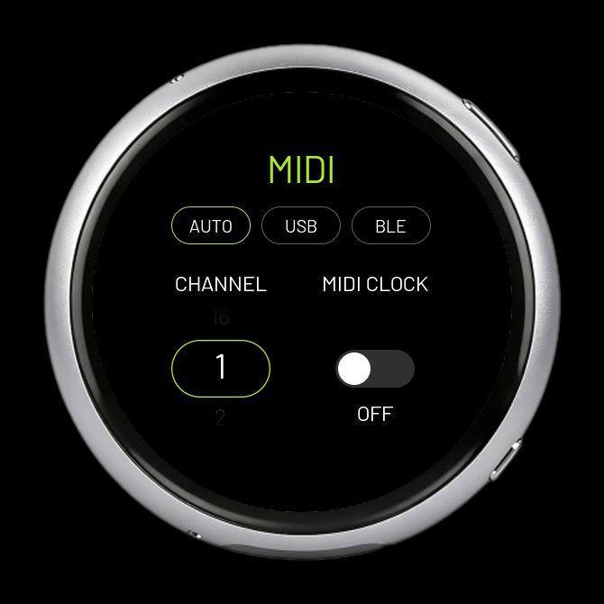
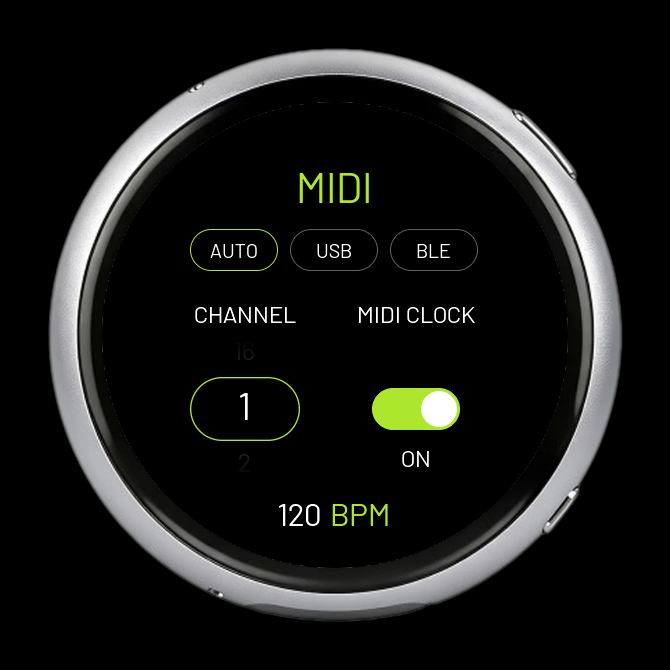

### MOTION CC — Bewegung als Modulation

Diese Seite liegt direkt hinter MIDI. Sie steuert zusätzlich zu den Noten in **allen vier Spielmodi** zwei frei zuweisbare MIDI-Controller über die Neigung des Geräts. **TRAVEL MODE muss OFF sein**, damit MIDI ausgegeben wird; der interne Synth reagiert nicht auf diese CCs.

| Einstellung | Funktion | Standard |
|---|---|---|
| MIDI CHANNEL | Eigener Kanal 1–16 für beide Bewegungsachsen, unabhängig vom Notenkanal. | 1 |
| X-AXIS | Links/rechts neigen; OFF oder CC 1–119. Die X-Richtung ist invertiert. | OFF |
| Y-AXIS | Vor/zurück neigen; OFF oder CC 1–119. | OFF |
| CALIBRATE | Die aktuelle, bequem gehaltene Position als Mitte speichern. | Waagerechte Referenz |

Alle drei Wheels scrollen **endlos in beide Richtungen**. Bei den Achsen folgt nach CC 119 wieder OFF; CC 1 ist die übliche Modulation. Die CC-Nummer wählt den Parameter am Zielinstrument, der übertragene CC-Wert liegt zwischen 0 und 127. Die CCs 120–127 sind spezielle Kanalbefehle und werden nicht angeboten.

**So einrichten:** TRAVEL MODE ausschalten, eine oder beide Achsen einem CC zuweisen, den eigenen MIDI CHANNEL wählen und das Gerät ruhig in der bevorzugten Spielhaltung halten. **CALIBRATE** antippen. Bei Erfolg erscheint **CALIBRATED** mit einer dezenten Farbfläche; Text und Hintergrund kehren nach drei Sekunden zum Normalzustand zurück. Ein neuer kurzer **PWR-Druck speichert und schließt** das Setup. Am empfangenden Instrument oder MIDI-to-CV-Modul den entsprechenden Kanal und CC zuweisen.

Die kalibrierte Mitte ergibt **64**. Jeweils **45° Neigung** decken die Endwerte 0 und 127 ab; darüber bleibt der Wert begrenzt. Eine **2°-Ruhezone** um die Mitte und Glättung reduzieren Zittern. Es gibt keine laufende Werteanzeige. Änderungen werden mit höchstens 25 Aktualisierungen pro Sekunde und Achse gesendet; ein regelmäßiger Refresh erneuert den aktuellen Wert.

Beide Achsen können gleichzeitig arbeiten. Menüs und ungültige oder veraltete Sensordaten pausieren die Ausgabe. Beim normalen Spielen läuft sie unabhängig von der gespielten Note und der MIDI-Clock. **Kanal, CC-Zuweisungen und bestätigte Kalibrierung bleiben nach dem Ausschalten erhalten**; LOAD / SAVE und Kopf-über-Reset ändern sie nicht. Eine gespeicherte frühere PITCH-Zuweisung wird zu OFF: Pitch Bend gehört nicht zu dieser Version.

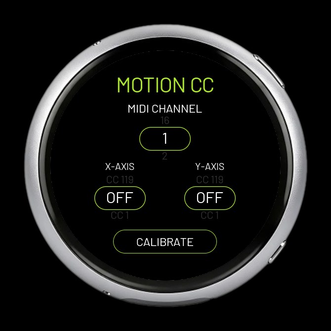
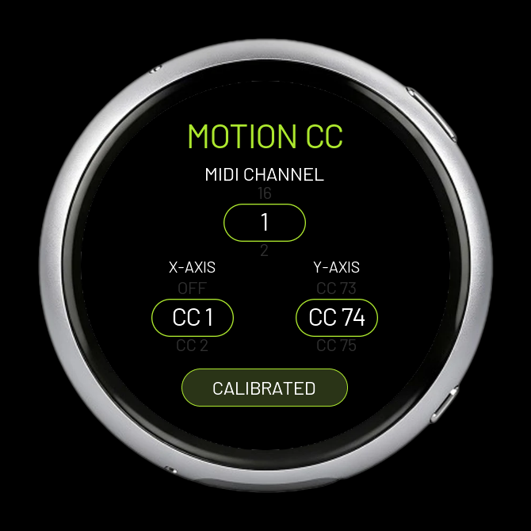

### UI COLOR

Den weißen Anfasser auf dem Farbring ziehen oder eine Stelle des Rings antippen. Die gewählte Farbe erscheint in der Mitte bei **UI COLOR** und färbt die Akzente der Oberfläche. Die Notenbeschriftung bleibt weiß. Standard ist Limegrün **#ACE72E**.

Zum Seitenwechsel innerhalb der freien Mitte beginnen; ein auf dem Farbring gestarteter Kontakt ist für die Farbwahl reserviert. Die bestätigte Farbe wird auch für das Bootlogo und den Ausschalt-Ring verwendet.

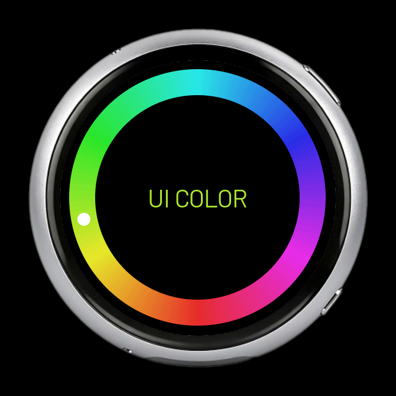

### TRAVEL MODE

**ON** spielt den internen Synth über den Lautsprecher und unterdrückt die MIDI-Notenausgabe. **OFF** verwendet wieder die MIDI-Ausgabe. Der Travel-Synth funktioniert ohne Computer und besitzt zehn Stimmen.

| Einstellung | Auswahl |
|---|---|
| WAVEFORM | Saw, Square, Triangle, Pulse, Sine; als Wellenformsymbole dargestellt. |
| ATTACK | 0 / 5 / 10 / 20 / 50 / 100 / 200 / 500 / 1000 / 2000 ms. |
| DECAY | 10 / 25 / 50 / 100 / 200 / 400 / 800 / 1200 / 2000 / 4000 ms. |

Die Wellenformauswahl ist zyklisch. Attack und Decay haben Anschläge bei Minimum und Maximum. Standard: **Travel ON, Square, Attack 50 ms, Decay 400 ms**. DECAY bezeichnet hier die Release-Zeit.

Attack steuert das Einschwingen. Solange der Finger gehalten wird, klingt die Note weiter. **DECAY bezeichnet hier den Ausklang nach dem Loslassen** – technisch eine Release-Zeit. Sine ist eine weiche Sinusvariante mit dezenten Obertönen; Pulse hat eine andere Pulsbreite als Square.

Die zehn Stimmen reichen für zwei vollständige Nonakkorde. Übersteigt die Anforderung die verfügbare Stimmenzahl, wird eine ältere Stimme ersetzt. Im Setup gibt es keine separate Klangvorschau: bestätigen, zum Spielbildschirm zurückkehren und dort hören.

### GLOBAL SCALE

Standard ist **ON**: Grundton und Skala werden zwischen Chords, Arpeggiator, Kinetic und Keyboard synchronisiert. Bei **OFF** kann jeder Modus seine eigene Auswahl behalten und ändern.

- **ON → OFF:** Alle vier Modi beginnen mit der zuletzt gemeinsamen Skala; danach sind ihre Auswahlen unabhängig.
- **OFF → ON:** Die Skala des Spielmodus, aus dem das Setup geöffnet wurde, wird für alle vier übernommen. Die bisherigen getrennten Auswahlen werden damit ersetzt.

Mit einem neuen kurzen PWR-Druck bestätigen. Die Synchronisierung betrifft nur Key und Skala, nicht Akkordvarianten, Strum, Oktavlagen, Arpeggiator-Notenauswahl oder Pattern.

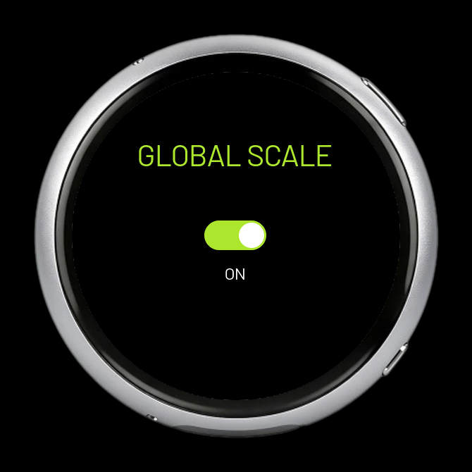
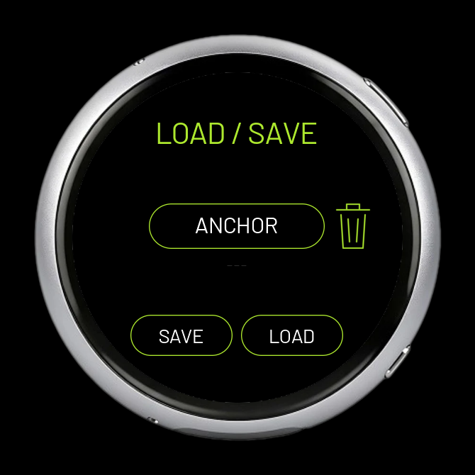

### LOAD / SAVE – musikalische Ideen speichern

Das mittige Wheel wählt einen von **acht Speicherplätzen**. Belegte Plätze zeigen ihren Namen, leere **---**. Rechts daneben befindet sich der Papierkorb. Bei leeren Plätzen sind Papierkorb und LOAD abgeblendet.

**Speichern:**

1. Einen leeren oder belegten Platz wählen und **SAVE** antippen.
2. Im nächsten Bildschirm mit acht unabhängigen, endlosen Buchstabenwheels einen Namen vergeben. Die Reihenfolge ist Leerzeichen, A–Z, 0–9 und wieder Leerzeichen.
3. Bei einem leeren Platz beginnen alle Zeichen leer; beim Überschreiben wird der bisherige Name vorgegeben.
4. Erst **SAVE im Namenseditor** schreibt die musikalische Momentaufnahme. **CANCEL** kehrt ohne Änderung zurück.

Führende Leerzeichen werden entfernt; Leerzeichen im Namen bleiben erhalten. Ein vollständig leerer Name ist zulässig und erscheint ebenfalls als **---**. Leere Plätze werden am Ende gesammelt; eine neue Idee wird im ersten freien Platz abgelegt.

**Laden:** Platz wählen, **LOAD** antippen und im zweiten Bildschirm den angezeigten Namen prüfen. Erst das zweite **LOAD** übernimmt die Einstellungen. **CANCEL** verändert nichts.

**Löschen:** Papierkorb antippen und auf dem zweiten Bildschirm mit **DELETE** bestätigen. **CANCEL** behält den Platz. Nach dem Löschen rücken die folgenden Ideen nach; ihre Reihenfolge bleibt erhalten.

In den drei Bestätigungsbildschirmen sind seitliche Seitenwechsel gesperrt. **PWR hat hier weder bei kurzem noch bei langem Drücken eine Funktion.** SAVE, LOAD und DELETE werden ausschließlich durch ihre jeweiligen Bestätigungsbuttons ausgeführt; nur **CANCEL** bricht den Dialog ab. Zurück in der Slot-Auswahl schließt ein neuer kurzer PWR-Druck das Setup.

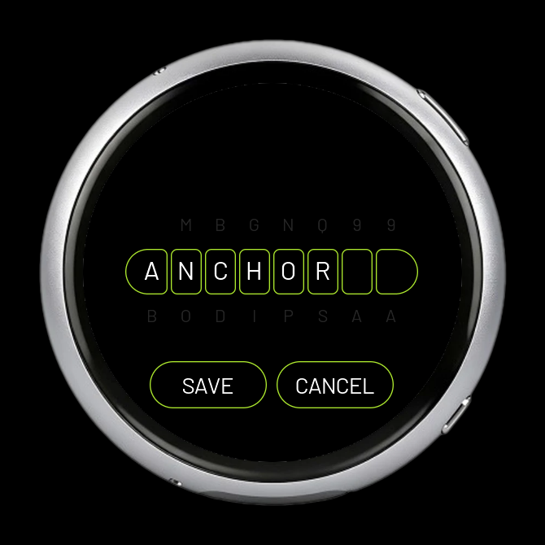
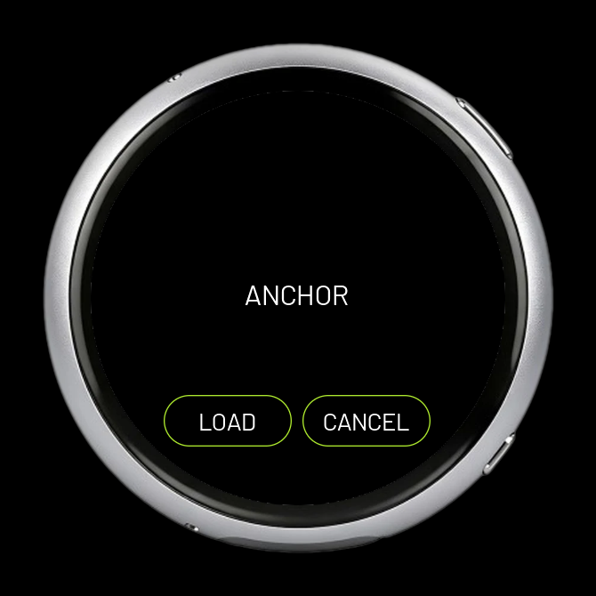

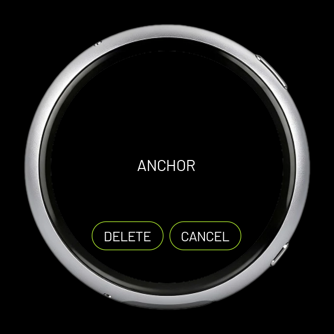
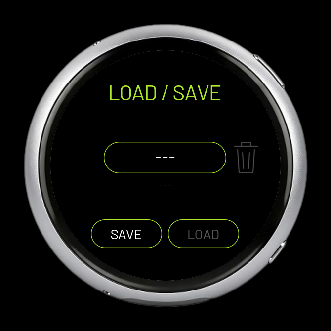

Ein Speicherplatz enthält:

- Key und Skala von Chords, Arpeggiator, Kinetic und Keyboard sowie **GLOBAL SCALE**.
- Keyboard-Oktave.
- Alle Chord-Varianten, Oktavversätze und beide Strum-Einstellungen.
- Arpeggiator-Oktaven, Pattern, Divisor und Rhythmusvariante, BPM, Probability, BLOCKSIZE, GATE, Ratchet samt Gate-Rückkehrwert, Swing, Notenauswahl und zuletzt gewählte Mittelseite.
- Kinetic-Skala, Oktavumfang, BPM, Divisor, Rhythmusvariante, Quantize, Gate und Lifetime.

**Laufende Kinetic-Bälle und Ballbahnen werden nicht gespeichert.** Alte Spielstände bleiben lesbar. Da sie keine Kinetic-Werte enthalten, verwendet das Laden dafür die neuen Standardwerte; bei GLOBAL SCALE ON mit der gemeinsamen Skala. Erneutes SAVE nimmt die gewünschte Kinetic-Konfiguration in den Spielstand auf.

**UI-Farbe, MIDI-Kanal, MIDI CLOCK, Motion-CC-Einstellungen samt Kalibrierung und Travel-Synth-Einstellungen bleiben global** und werden beim Laden nicht verändert. Die aktuelle MIDI-CLOCK-Einstellung hat Vorrang. Laufende Noten werden vor dem Laden beendet; alte Clock-, Transport- oder Pattern-Fortschritte werden nicht abgespielt. Nach Verlassen des Setups startet ein internes Arpeggio mit der geladenen Notenauswahl; externe Clock wartet auf Start/Continue.

Gespeicherte Ideen werden durch späteres Spielen und Verändern **nicht automatisch überschrieben**. Das automatische Sichern des laufenden Arbeitsstands erfolgt unabhängig davon.

## 8. BLE-MIDI und Ableton Live

Das Gerät bietet **USB-MIDI** und **BLE-MIDI**. USB erscheint als **BAX:KI:ZL MIDI**, Bluetooth als **BAX:KI:ZL**. Beide Verbindungen übertragen Noten und empfangen MIDI Clock.

**Erprobte Wege:** Der Projektinitiator nutzt Windows/Ableton per USB und SmplTrek/Eurorack kabellos über CME WIDI. Über den Windows-BLE-Rückweg zu Ableton wurden trotz stabiler Clock-Verarbeitung schwankende Notenabstände beobachtet. Mit WIDI lief derselbe Aufbau stabil. Das ist eine Beobachtung dieses Systems, keine Garantie für sämtliche PCs oder Empfänger. Ein Android-Test steht noch aus.

### Per USB mit Windows/Ableton verbinden

Ein datenfähiges USB-Kabel anschließen, das Gerät aus der Ladeansicht starten und im MIDI-Setup **USB** oder **AUTO** wählen. In Ableton den Eingang **BAX:KI:ZL MIDI** aktivieren. AUTO bevorzugt eine verfügbare USB-MIDI-Verbindung und wechselt beim Abziehen auf BLE. Die MIDI-Clock-Ausgabe in Ableton immer auf den tatsächlich verwendeten Endpunkt richten.

### Unter Windows per BLE verbinden

Der erprobte Weg nutzt **Windows MIDI Bluetooth Setup** mit dem separat installierten BLE-MIDI-Preview-Transport von Windows MIDI Services. Voraussetzungen und Downloads: [offizielle Microsoft-Anleitung](https://microsoft.github.io/MIDI/tools/midibluetoothsetup/).

1. BAX:KI:ZL einschalten und Bluetooth am PC aktivieren.
2. In **Windows MIDI Bluetooth Setup → Bluetooth devices** das Gerät **BAX:KI:ZL** auswählen und **Connect** drücken.
3. Nach erfolgreicher Verbindung den MIDI-Eingang in der DAW auswählen. Die Setup-Anwendung kann danach geschlossen werden.

**Bluetooth-Pairing allein genügt nicht:** Die Verbindung muss auch als MIDI-Endpunkt für die Musiksoftware verfügbar sein. Im seriellen Monitor zeigt **MIDI READY**, dass die MIDI-Notifications eingerichtet sind. Das Gerät akzeptiert gleichzeitig einen BLE-Zentralpartner.

### Ableton als Instrument verwenden

1. Am Gerät **TRAVEL MODE OFF** bestätigen.
2. In Lives Einstellungen **Link, Tempo & MIDI** beziehungsweise **Tempo & MIDI** öffnen.
3. Beim gewählten Eingang **BAX:KI:ZL MIDI** (USB) oder **BAX:KI:ZL** (BLE) **Track ON**, **Sync OFF**, **Remote OFF** wählen.
4. Eine MIDI-Spur mit einem Instrument anlegen. Als Eingang den gewählten USB-/BLE-Endpunkt oder All Ins wählen, mit passendem MIDI-Kanal oder All Channels.
5. Monitoring **In** wählen – oder **Auto** mit aufnahmebereiter Spur. Dann auf dem Gerät spielen.

Die Begriffe und die Bedeutung von Track, Sync und Remote erläutert [Ableton: MIDI Settings](https://help.ableton.com/hc/en-us/articles/209774205-Live-s-MIDI-Settings).

### Ableton als Taktgeber verwenden

| Port in Ableton | Track | Sync | Remote |
|---|---|---|---|
| Input des gewählten USB-/BLE-Endpunkts | ON | OFF | OFF |
| Output desselben USB-/BLE-Endpunkts | OFF | ON | OFF |

**Live bleibt Taktgeber; EXT bleibt OFF.** Am Gerät MIDI CLOCK ON und für Ableton-Instrumente TRAVEL MODE OFF bestätigen. Den Arpeggiator vorbereiten, dann in Live einen frischen Start auslösen. Live sendet Clock und Transport; BAX:KI:ZL sendet die Arpeggio-Noten zurück. Grundlage: [Ableton-Handbuch zur MIDI-Synchronisation](https://www.ableton.com/en/manual/synchronizing-with-link-tempo-follower-and-midi/).

Keinen Sync-Eingang für den Controller aktivieren, wenn Live selbst die Clock senden soll. Für die reine Notenverwendung ohne Clock wird kein Sync-Ausgang benötigt.

## 9. Ausschalten und Akkuanzeige

**BOOT drei Sekunden halten.** Der Bildschirm wird schwarz, mittig erscheint **POWER OFF**, und der Ring in UI-Farbe baut sich ab. Wenn er vollständig abgebaut ist, schaltet das Gerät ohne USB aus. Mit angeschlossenem USB-Kabel wechselt es stattdessen in den Ladebildschirm.

Musik und laufende Muster bleiben während des Power-Off-/Akku-Checks hörbar. Lässt du vorher los, wird das Ausschalten abgebrochen und die vorherige Ansicht erscheint wieder. Erst das bestätigte Ausschalten beendet die Ausgabe.

Unter dem Text steht ein Batteriesymbol mit weißem Rand und bis zu **fünf Balken in UI-Farbe**. Es ist eine grobe Ladezustandsanzeige. Bei **USB-Versorgung** erscheint stattdessen ein **Blitz**, auch bei vollem Akku: Im laufenden Instrument zeigt er die Stromquelle an, nicht den momentanen Ladestrom. Die Balkenzahl ist keine Vorhersage der verbleibenden Laufzeit.

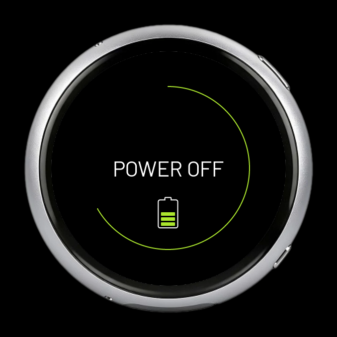
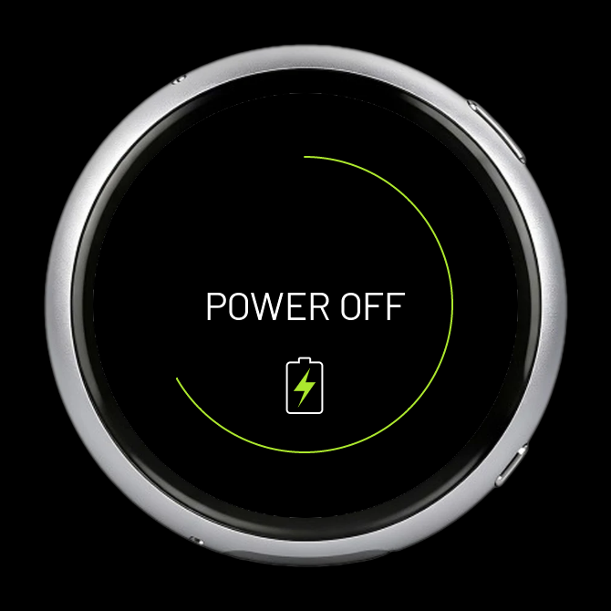

### Ladebildschirm

Wird das ausgeschaltete Gerät durch Einstecken des USB-Kabels gestartet, erscheint eine **kleine Batterie mittig auf schwarzem Hintergrund**. Dieselbe Ansicht erscheint nach dem Ausschalt-Countdown, wenn USB angeschlossen ist. Wird USB dagegen im normalen Betrieb eingesteckt, bleibt das Instrument spielbar.

Der höchste gefüllte Balken blinkt im Halbsekundentakt, solange noch kein Ladeabschluss gemeldet wurde. Bei leerem Akku blinkt der erste Balken. Nach vollständiger Ladung stehen alle fünf Balken dauerhaft; nach **einer Minute durchgehendem Ladeabschluss** fordert das Gerät die Abschaltung an. Abziehen des Kabels schaltet aus der Ladeansicht ebenfalls ab. Ein **neuer PWR-Druck** wechselt zum Instrument mit Bootlogo.

Die Ladeansicht spielt keine Noten und startet keine BLE-Verbindung. Ein Fragezeichen bedeutet unbekannte Akkudaten, ein X eine nicht erkannte Batterie. Solche Zustände werden nicht als voller Akku behandelt.

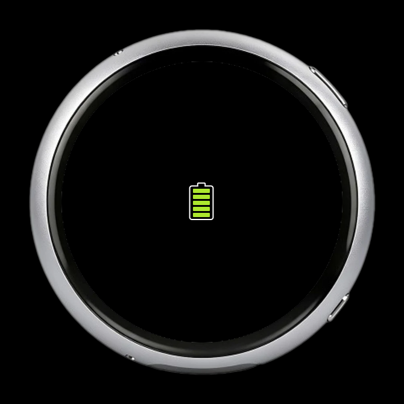

## 10. Was wird gespeichert?

| Bleibt nach dem Ausschalten erhalten | Beginnt nach einem Neustart neu |
|---|---|
| Key/Mode aller vier Modi und GLOBAL SCALE. | Spielmodus: Chords. |
| Varianten und Oktavversätze aller Chord-Buttons; beide Strum-Auswahlen. | Keyboard-Oktave: 4, sofern nicht per LOAD wiederhergestellt. |
| Alle Arpeggiator-Einstellungen einschließlich BPM, GATE, Ratchet, Notenauswahl und zuletzt gewählter Mittelseite. | Position im Pattern, laufende Noten, Tap-Zeitstempel und externe Clock-Messung. |
| Kinetic-Skala, Oktaven, BPM, Timing, Quantize, Gate, Lifetime. | Kinetic beginnt ohne Bälle; laufende Noten und Ballbahnen werden nicht gespeichert. |
| Alle acht manuell gespeicherten Ideen mit ihren Namen. | Externer Transport wartet auf Start/Continue. |
| MIDI-Kanal, MIDI CLOCK, UI-Farbe, Travel Mode, Wellenform, Attack und Decay. | Zuletzt geöffnete Setup-Seite: MIDI. |

In Skalenwahl und Chord-Editor speichert **SELECT oder ein kurzer PWR-Druck**; globale Setup-Werte bestätigt der neue kurze **PWR-Druck**. SAVE, LOAD und DELETE besitzen eigene Bestätigungen. Arpeggiator-Änderungen werden **automatisch direkt im nächsten UI-Zyklus** gespeichert: auch Notenauswahl, erkannte Tap-BPM und die Mittelseite. Es werden nur tatsächliche Wertänderungen geschrieben, keine Zwischenpixel beim Ziehen, Clock-Ticks oder gespielten Noten.

Die Lage-Resets von Chords und Arpeggiator werden gespeichert; Key und Skala bleiben erhalten. Kinetic leert nur die Bälle und lässt seine Einstellungen unangetastet. Nach einem Neustart kann der Arpeggiator am letzten Arbeitsstand weiterverwendet werden, beginnt das Muster dabei aber neu. Ohne externe Clock und mit aktivierten Noten läuft er beim Wechsel in seinen Spielmodus an. Beim Ausschalten wird zusätzlich auf noch ungespeicherte Änderungen geprüft. Ein plötzlicher Stromverlust kann die allerletzte noch nicht abgeschlossene Änderung verlieren.

## 11. Windows-Companion und Simulator

### Portable Anwendung

**BAX-KI-ZL-Companion.exe** aus dem aktuellen Paket starten. Die Startseite besitzt zwei Buttons: **Flash Firmware** und **Run Simulator**. Das Fenster bleibt quadratisch; Logo, Schrift, Buttons und Abstände der Startseite skalieren proportional. Die Oberfläche und ihre Fehlerhinweise sind auf Englisch. Firmware, Simulator, Gehäusemaske und Laufzeitbibliotheken sind in der EXE enthalten. Logo, Button-Umrandungen und Flash-Dialoge ?bernehmen die im Simulator best?tigte UI-Farbe bei der R?ckkehr ins Hauptmen? und beim n?chsten App-Start. Ohne gespeicherte Auswahl gilt Limegr?n #ACE72E. Der Waveshare beh?lt seine eigenen Farbeinstellungen.

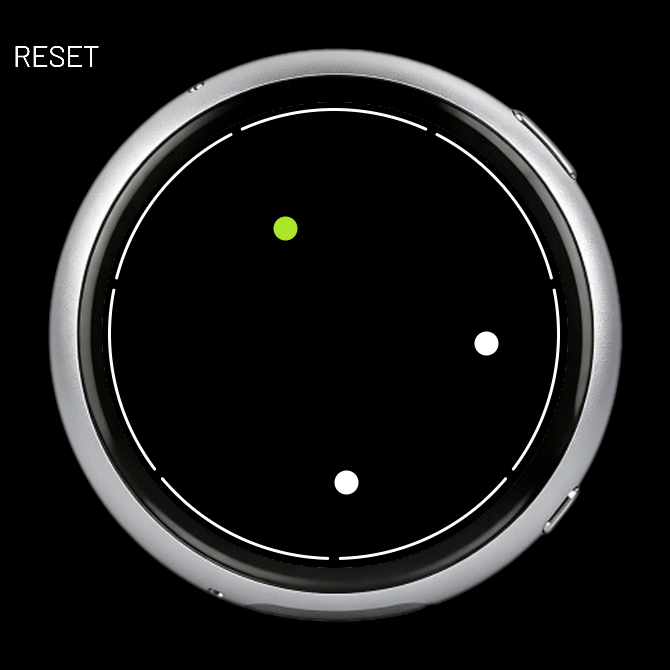

Zum lokalen Ausführen genügt die EXE. Zum Veröffentlichen und Weitergeben das **ZIP-Paket** mit Anleitung, Lizenzhinweisen und den mitgelieferten Quellen verwenden. Nach Austausch der EXE eine bereits laufende Companion-Version schließen und die neue starten.

### Firmware flashen

1. Das **Waveshare 1.75C, SKU 33691, 32 MB Flash** per USB-Datenkabel verbinden. Andere serielle Monitore schließen.
2. **Flash Firmware** wählen. Die Anwendung sucht nach dem BAX:KI:ZL-CDC-Port und dem Espressif-USB-Bootloader.
3. Den Anschluss in **Confirm flash port** prüfen. Bei mehreren Treffern ist eine ausdrückliche Auswahl erforderlich. Die USB-Kennung des ROM-Bootloaders allein beweist das Boardmodell nicht.
4. **Start Flash** drücken. Das Paket wird auf Vollständigkeit, Flashbereiche und Prüfsummen geprüft. Die Anwendung verfolgt den Portwechsel zum Bootloader über USB-Position beziehungsweise Seriennummer und schreibt anschließend direkt, **ohne automatisches Firmware-Backup**.
5. Statusbalken und Protokoll beobachten, USB nicht trennen. **Firmware flashed successfully** bestätigt das Schreiben einschließlich Datenprüfung. Der COM-Port darf sich beim Neustart ändern.

Gespeicherte Einstellungen und Slots im NVS-Bereich werden nicht gelöscht. Der Companion flasht die **eingepackte Version**; er lädt keine Firmware aus dem Internet und kompiliert keine neue. Für eine neuere Firmware ist ein entsprechend neu gebautes Paket nötig. Während des Flashens kann die Anwendung nicht geschlossen werden.

Bei Fehlern zeigt der Companion Wiederherstellungshinweise. **Scan Again** sucht erneut. **Open Logs** öffnet den Benutzerordner mit den Protokollen. Für BOOT-Recovery: USB trennen, BOOT halten, USB anschließen und BOOT loslassen; bei noch eingeschaltetem Akkugerät BOOT während eines Neustarts halten. Danach den neu angezeigten Port bestätigen und erneut flashen.

### Simulator im Companion

**Run Simulator** zeigt den vollständigen Simulator **im selben Fenster**. Oben links außerhalb des Gerätebilds steht gut lesbar **RESET**, entsprechend der Kopf-über-Geste. Die Beschriftung erscheint nur bei veränderten Akkordbelegungen, zurücksetzbaren Arpeggiator-Werten oder vorhandenen Kinetic-Bällen. In Menüs, im Keyboard und im unveränderten beziehungsweise leeren Zustand ist sie ausgeblendet. **Rechtsklick** öffnet und schließt das Kinetic-Menü. Einen zusätzlichen Zurück- oder Zwei-Finger-Button gibt es nicht.

Um zur Companion-Startseite zurückzukehren, das simulierte Gerät normal ausschalten: unteren Gehäusebutton oder **B drei Sekunden halten**. Alternativ die gesamte Anwendung schließen.

Der Companion speichert seine eigenen Dateien unter **%LOCALAPPDATA%\BAX-KI-ZL**: `logs` enthält Flash- und Simulator-Protokolle; `simulator` die entpackte Anwendung, Maske, Laufzeitbibliotheken und Einstellungen. Frühere Backups werden nicht automatisch gelöscht. Die separate Projektaktion `Firmware.ps1 -Action Backup` bleibt für eine bewusst angeforderte Sicherung verfügbar.

### Direktstart und Eingaben

Im Projektordner startet **Starten.cmd** den Simulator auch direkt. Er benötigt keine angeschlossene ESP32-Hardware. Die sichtbare Kreisfläche entspricht den 466 × 466 Displaypixeln, das Gehäuse dient als Maske und Orientierung.

Das Fenster lässt sich skalieren. Die physische Größe am Monitor hängt zusätzlich von Bildschirmauflösung und Windows-Skalierung ab; sie ist nicht automatisch ein maßstabsgetreues Abbild des 1,75-Zoll-Displays.

| Maus oder Taste | Entsprechung |
|---|---|
| Linke Maustaste halten/ziehen | Erster Touchkontakt und Gesten. |
| Rechte Maustaste halten | In Chords/Keyboard zweiter festgehaltener Kontakt; in Kinetic öffnet/schließt ein Rechtsklick das Menü. |
| Mausrad über einem Auswahlfeld | Wheel verstellen. |
| Oberer Gehäusebutton oder P | PWR; kurz und lang wie am Gerät. |
| Unterer Gehäusebutton oder B | BOOT; drei Sekunden halten beendet nach dem Countdown den Simulator. |
| + / − | Keyboard-Oktave höher / tiefer. |
| Esc | Offenes Setup oder Auswahlfenster verwerfen. |
| Strg + Umschalt + R | Reset-Aktion im aktuellen Chord-/Arpeggiator-/Kinetic-Modus auslösen. Keine Simulation der eigentlichen Bewegungserkennung. |
| Strg + Pfeiltasten | Virtuelle Neigung im Simulator um 3° ändern, um Motion CC zu testen. |
| Strg + Pos1 | Virtuelles Gerät wieder waagerecht halten. |
| RESET oben links | Dieselbe Reset-Aktion; nur sichtbar, wenn außerhalb eines Menüs tatsächlich etwas zurückgesetzt werden kann. |

Der Simulator hat lokale Audioausgabe für Travel Mode. Seine MIDI-Ausgabe ist derzeit eine **Konsolenvorschau**, keine BLE-Verbindung zu Ableton. Die gemeinsamen UI- und Musikfunktionen entsprechen dem Gerätecode; Sensorik, Stromversorgung und Funkverhalten müssen am Gerät geprüft werden.

## 12. Wenn etwas nicht wie erwartet reagiert

| Beobachtung | Zuerst prüfen |
|---|---|
| Kein Ton am Lautsprecher | Travel Mode ON? Setup mit neuem kurzem PWR-Druck bestätigt? |
| Keine Bewegungsmodulation | Travel OFF, Achse nicht OFF, korrekter separater MIDI-Kanal, CC-Zuweisung am Empfänger und CALIBRATE bestätigt? |
| Kein MIDI in Ableton | Travel Mode OFF? BLE-MIDI-Endpunkt verbunden? Input Track ON, passender Kanal, Instrument und Spurmonitoring aktiv? |
| Arpeggiator bleibt stumm | Mindestens eine Note aktiv? MIDI CLOCK eingeschaltet und externer Transport noch nicht gestartet? Bei kleiner Probability mehrere Schritte abwarten. |
| Arpeggiator hat Lücken | Probability, BLOCKSIZE und die gewählte Notenfolge prüfen. Bei extrem hohen Oktaven kann der MIDI-Tonvorrat begrenzt sein. |
| Einstellungen nach Neustart anders | Wurde in einem Auswahlfenster SELECT beziehungsweise im Setup PWR kurz bestätigt? Arpeggiator-Werte werden automatisch gespeichert; seine Pattern-Position und Clock-Messung beginnen neu. |
| Ratchet klingt kaum hörbar | GATE und Ausklang des Klangerzeugers prüfen. Langes DECAY kann die Wiederholungen verschmelzen lassen. |
| Gerät zeigt beim USB-Anstecken nur eine Batterie | Das ist der Ladebildschirm. Mit einem neuen PWR-Druck zum Instrument wechseln. |
| Seitenwechsel reagiert nicht | Die Wischgeste in einer freien Fläche statt in einem Wheel, Notenbutton oder Farbring beginnen. |
| Lage-Reset reagiert nicht | Spielmodus Chords/Arpeggiator/Kinetic? Keine Finger auf dem Display, kein Menü offen, PWR nicht gehalten? Erst deutlich aufrichten, dann eine Sekunde ruhig mit Display nach unten halten; höchstens etwa 40 Grad schräg. |
| Alter BLE-Name erscheint | Verbindung trennen und neu verbinden. Bei Bedarf den alten Windows-Bluetooth-Eintrag entfernen und erneut verbinden, Ableton danach neu öffnen. |
| Flashen meldet belegten COM-Port | Den seriellen Monitor beziehungsweise andere Anwendungen auf diesem Port schließen und den aktuellen COM-Port prüfen. |

Bei Verbindungsabbrüchen und bestimmten Menüwechseln werden Noten beendet. Eine noch aufliegende Hand wird dabei gegebenenfalls bis zum Loslassen gesperrt. Finger lösen und neu anschlagen. Die beschriebenen Ausnahmen gelten weiterhin: Musik läuft beim Akku-Check und im Kinetic-Menü weiter.

### Stand und Grenzen dieses Manuals

Dieses Manual beschreibt **Firmware V1.1 mit Quellcode- und Build-Stand vom 07/11/2026**. Die Bilder stammen aus einer isolierten Simulator-Aufnahme mit Standardfarben; persönliche Einstellungen und Speicherplätze bleiben unberührt.

Bedienung, Travel-Synth, USB-MIDI, WIDI, Kinetic (in früheren Experimenten auch mit bis zu zwölf Bällen), Zweifinger-Spiel und Ableton-Clock wurden vom Projektinitiator am Gerät erprobt. Automatisierte Tests ergänzen diese Praxistests, ersetzen aber keine vollständige Hardwareprüfung. Das berichtete direkte Spielgefühl ist keine gemessene Latenzangabe.

Der Companion wurde mit automatisierten UI-, Datei-, Flash-Ablauf- und Windows-Einbettungstests geprüft. Ein echter Flash über diese neue Oberfläche ist hier nicht als erfolgreich getestet dokumentiert. Ein Knacken des Lautsprechers beim Hardware-Reset während des Flashens ist nicht sicher ausgeschlossen; das wurde als akzeptable Grenze festgehalten.

Noch nicht enthalten sind Pitchbend, eine eigene ESP-NOW/DIN-MIDI-Brücke, Hum-to-MIDI oder automatische Key-Changes. CME WIDI wird als fertiger BLE-/DIN-MIDI-Empfänger genutzt. Diese Anleitung nimmt solche späteren Erweiterungen nicht vorweg.

Build- und Entwicklerhinweise stehen im Quellprojekt in `README.md` und `firmware/README.md`. Weitere technische Dokumentation liegt im Projektordner `docs`.
