<section class="cover">
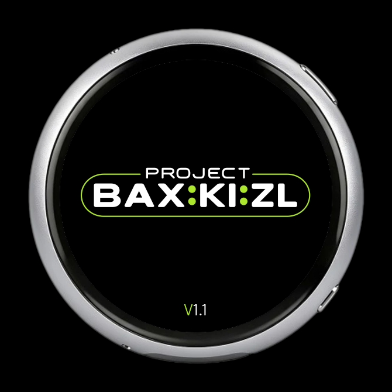

Chords · Arpeggiator · Kinetic · Keyboard

V1.1 – 11/07/2026

Waveshare ESP32-S3-Touch-AMOLED-1.75C · SKU 33691

</section>

A small instrument for exploring melodies, harmonies and rhythmic patterns, using its built-in travel synth or MIDI to play other instruments.

The boot screen shows **V1.1** at the bottom: V uses the UI accent and 1.1 is white. It fades with the logo. The centre selection double-tap window is 400 ms.

### How this project was created

BAX:KI:ZL was developed through a collaboration between the project initiator and the AI coding assistant **OpenAI Codex**. The project initiator contributed the idea, musical goals, interaction concept, visual direction and decisions about which features belong in the instrument. He guided development through detailed requirements, many refinements and extensive practical tests on the device and with Ableton.

Codex carried out the technical implementation: hardware and documentation research, software architecture, source code, debugging, automated tests, build preparation, the simulator and documentation, including this manual. The software was therefore developed with AI assistance; it was not programmed solely by the project initiator. Existing libraries and board drivers provide its technical foundations and retain their respective authorship and licenses. **KI**, the German abbreviation for AI, is also part of the name to acknowledge this openly.

**About the pictures:** The screenshots in this manual were generated using the current Windows simulator. The enclosure provides orientation; the accent color shown is lime green. Clock and battery values in the illustrations are simulated examples.

<h2 class="contents-title">Contents</h2>

[TOC]

## 1. Quick start

### Install the firmware or try it on your PC

The portable **BAX-KI-ZL-Companion.exe** includes the firmware and simulator. It does not require Python, ESP-IDF or Visual Studio on your PC.

1. Choose **Run Simulator** to try the instrument inside the Companion window, without connecting a Waveshare.
2. To install firmware, connect the board using a USB data cable, close serial monitors and choose **Flash Firmware**.
3. Check the detected port and confirm **Start Flash**. Select only the **Waveshare ESP32-S3-Touch-AMOLED-1.75C, SKU 33691, with 32 MB flash**. A USB bootloader might belong to another ESP32 board.
4. Keep USB connected until success is confirmed. After package validation, flashing starts directly, **without an automatic backup**. Saved device settings are retained.

The EXE alone is sufficient to run the application. For redistribution, use the ZIP containing instructions, licenses and the supplied source code. Chapter 11 explains the Companion in detail.

### Play without a computer

1. Turn the device on using **PWR**. Release the power button completely.
2. **Chords** appears after the logo.
3. **Hold PWR for approximately 0.6 seconds** to open Setup.
4. Swipe sideways to **TRAVEL MODE** and switch it **ON**.
5. **Press PWR briefly again** to save and close Setup.
6. Touch and hold a ring button. The internal speaker plays its chord. Releasing it starts the selected fade-out.

A short PWR press cycles through **Chords → Arpeggiator → Kinetic → Keyboard → Chords**.

### Play Ableton or another MIDI instrument

Set **TRAVEL MODE OFF** in Setup and confirm with a short PWR press. For Windows/Ableton, connect USB and select **BAX:KI:ZL MIDI**; the wireless endpoint is **BAX:KI:ZL**. See chapter 8 for Ableton settings.

**No sound?** Check the output mode first: Travel ON plays the built-in synth; Travel OFF sends MIDI.

### Save an idea and load it again

1. **Hold PWR for about 0.6 seconds**, then swipe to **LOAD / SAVE**.
2. Select an empty **---** slot and tap **SAVE**.
3. Set a name using the eight character wheels. **SAVE in the name editor** writes the idea; **CANCEL** leaves it unchanged.
4. To recall an idea, select its occupied slot and tap **LOAD**. Check the name on the next screen, then tap **LOAD again**.
5. You return to the slot overview. **Press PWR briefly** to leave Setup and continue playing.

There are **eight slots** for the musical settings of all four modes: Keyboard, Chords, Arpeggiator and Kinetic. Live balls are not saved. **PWR does nothing in the SAVE, LOAD and DELETE confirmation screens**, whether pressed briefly or held. Use the action button or CANCEL. See LOAD / SAVE in chapter 7.

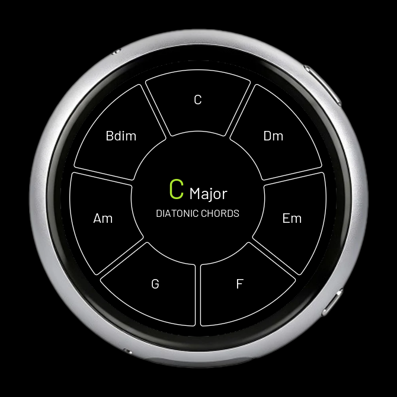
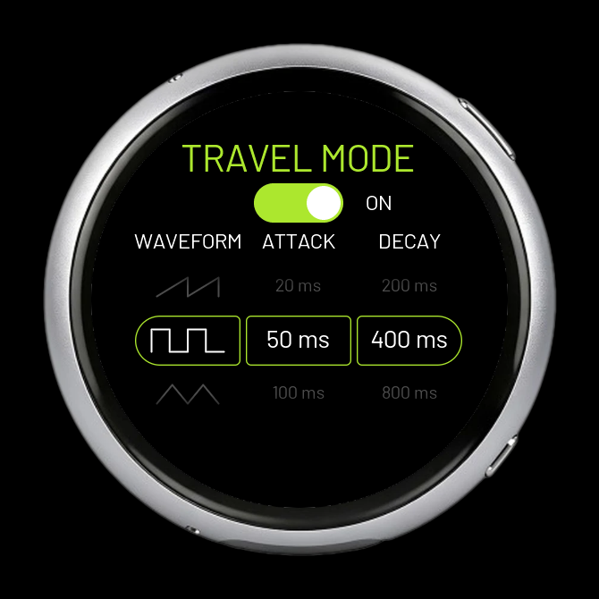

## 2. Buttons, gestures and selectors

The pictures use this enclosure orientation: **PWR at the upper right**, **BOOT at the lower right**.

| Control | Action |
|---|---|
| Short PWR press | Cycle Chords → Arpeggiator → Kinetic → Keyboard → Chords. In Setup, save and close instead. |
| Hold PWR for about 0.6 seconds | Open Setup. Holding this button does not shut the device down. |
| Hold BOOT | Show the power-off screen. After three seconds in total, shut down without USB or enter the charging screen with USB connected. |
| Release BOOT early | Cancel shutdown and restore the previous screen. Music continues during the battery check. |
| Double-tap the center | Open scale selection in Keyboard or Chords. |
| Drag vertically over a wheel | Change its value; the wheel snaps to an item after release. |
| Swipe horizontally across a free menu area | Move between Setup or Arpeggiator pages. |

A single tap in the center does not open scale selection, helping prevent accidental menu entry while playing.

**Changing pages:** In Arpeggiator, start above the selectors. In Setup, use a free area; on the color page, swipe through the empty center. A gesture started inside a scroll wheel stays with that wheel and cannot also change pages.

**Confirming:** Scale selection and the Chord editor accept **SELECT or a short PWR press**. Setup requires a **new short PWR press**; simply releasing the long opening press does not confirm. In SAVE, LOAD and DELETE confirmation screens, PWR is completely inactive.

### Face-down reset

On the unobstructed Chords, Arpeggiator or Kinetic play screen, remove your fingers and hold the device **still with its display facing down for one second**. The display may be tilted by up to approximately **40 degrees from horizontal face-down**. Turning it away, moving too strongly or touching it cancels the countdown. This replaces the earlier shake gesture.

| Mode | Result and visible feedback |
|---|---|
| Chords | All seven buttons return to Triad and octave shift 0; their outlines turn white. Key, scale and the global strum choices are retained. |
| Arpeggiator | All notes deselected; playback becomes silent. Defaults: octaves 3–5, UP, 1/8 STRAIGHT, 120 BPM, Probability 100%, BLOCKSIZE OFF, GATE 100%, RATCHET EVERY OFF / COUNT 2, Swing 0. The center returns to SCALE. Key, scale and global settings are retained. |
| Kinetic | All balls and queued notes cleared. Every setting remains unchanged, including key, scale, timing, octave range, Gate, Lifetime and BPM. |
| Keyboard | No orientation-triggered reset. |

Reset is disabled during touch input, in Setup or selection screens, and during shutdown. **There is no fixed cooldown.** Before another reset, clearly turn the display away from face-down for at least **0.1 seconds**, then hold it face-down for another second. You need not keep still while turning it upright and may already touch a button. Keeping it face-down will not repeatedly reset it. After startup or a play-mode change, first hold it upright normally.

## 3. Chords — play diatonic chords

Chords presents **seven chord buttons**. The first scale degree sits at twelve o'clock; the others follow clockwise. The center shows the key in the UI color and the scale in white, with **DIATONIC CHORDS** below.

In C Major, the default chords are **C, Dm, Em, F, G, Am and Bdim**. Play them freely; no progression is prescribed.

**Touch and hold** to play; **release** to stop. In Travel Mode, released notes fade according to DECAY. Default voicings are spread out, using a triad plus a doubled root for four voices. Ninth chords use five different notes.

Two fingers can play **two complete chords simultaneously**. Shared pitches are retriggered by the new chord; releasing one chord does not stop a pitch still held by the other. Released voices may continue fading in Travel Mode.

### Choose the key and scale

Double-tap the center. Choose key and mode on the left and the strum interval on the right. **SELECT or a short PWR press** applies and saves the selection.

With **GLOBAL SCALE ON**, key and scale are shared by all four play modes. With it OFF, this changes Chords only. Per-button variants, octave shifts and strum choices survive scale changes.

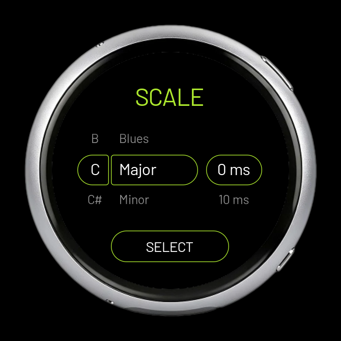
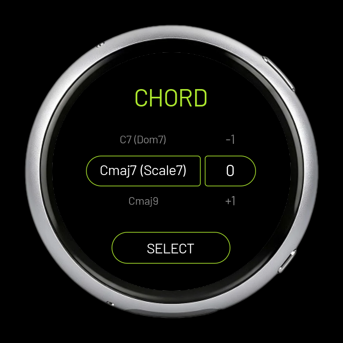

### Edit a chord button

1. Put your finger **in the center**.
2. Drag to the ring button you want to edit.
3. Release there. The **CHORD** editor opens without playing that button.
4. Choose the chord variant on the left and octave shift **−1, 0 or +1** on the right.
5. Confirm and save using **SELECT or a short PWR press**.

**Audition changes:** Each actual change of variant or octave shift plays the draft chord once, through the speaker in Travel Mode or over MIDI otherwise. STRUM applies. After its last note starts, the complete chord remains held for approximately **0.6 seconds**, then releases with the Travel synth's configured fade-out. A new choice replaces the previous preview. Opening the editor without changing anything, or scrolling against an octave limit, does not trigger another preview.

Leaving the editor stops the preview. Without confirmation, the saved assignment stays unchanged; auditioning alone does not save it.

| Option | Effect; example for C in C Major |
|---|---|
| Triad | The degree's normal triad, C. Default for every button. |
| Maj/Min | Change major to minor or vice versa: C becomes Cm. Minor and diminished degrees become major. |
| Dom7 | Major chord with a minor seventh: C7. |
| Scale7 | Add the scale's seventh: Cmaj7; Dm becomes Dm7 and G becomes G7. |
| Ninth | Seventh chord plus a major ninth: Cmaj9. |
| Sus4 | Replace the third with a fourth: Csus4. |
| Sus2 | Replace the third with a second: Csus2. |
| Diminished | Diminished chord: Cdim. |
| Augmented | Augmented chord: Caug. |

A **white outline** means Triad with octave shift 0. An outline in the **UI color** means the variant or octave shift was changed. Assignments remain attached to their scale degrees when key or scale changes; names and pitches are recalculated.

An octave shift transposes that button's entire chord. Moving around the ring does not progressively shift its register. Default triads come from the selected scale, while edited variants may intentionally introduce outside notes, for example through major/minor changes, suspensions or a major ninth.

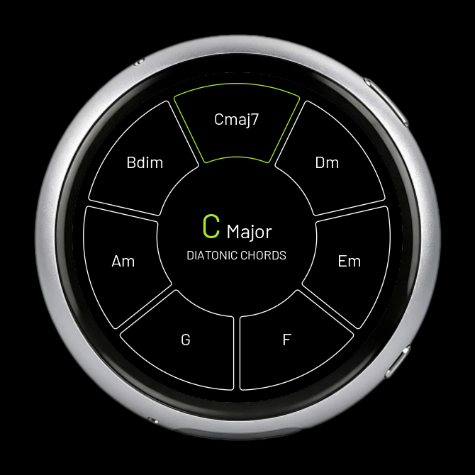

### Strum — play chord notes one after another

The right wheel in Chord scale selection sets the gap between notes, played **from low to high**. The first note starts immediately; others follow at the selected interval. Notes remain held until release, which also cancels pending notes.

| MIDI CLOCK | Display and behavior |
|---|---|
| OFF | 0–250 ms in 10 ms steps. Zero plays all notes together; nonzero gaps vary subtly by ±10%. |
| ON | OFF or musical note values. Incoming MIDI tempo determines the interval, without timing randomization. |

Clock choices are **OFF · 1/512 · 1/256 · 1/128 · 1/64 · 1/32T · 1/32 · 1/32D · 1/16T · 1/16 · 1/16D · 1/8T · 1/8 · 1/8D · 1/4T · 1/4 · 1/4D**.

**T** means triplet, two thirds of the normal interval. **D** means dotted, 1.5 times the normal interval. Each triplet therefore appears before the straight value, followed by dotted.

At 120 BPM, 1/8 is 250 ms, 1/8T approximately 167 ms and 1/8D 375 ms. Four chord notes need three such gaps to reach the last note.

Milliseconds and clock divisions are saved separately; changing MIDI CLOCK restores the previous choice for that timing source. Tempo changes affect an ongoing strum. **The initial touch is not quantized to a global grid.**

If clock stops arriving, strum uses the last received tempo; before any clock measurement, it uses 120 BPM. MIDI Start/Stop does not trigger chords: touch still controls playing them.

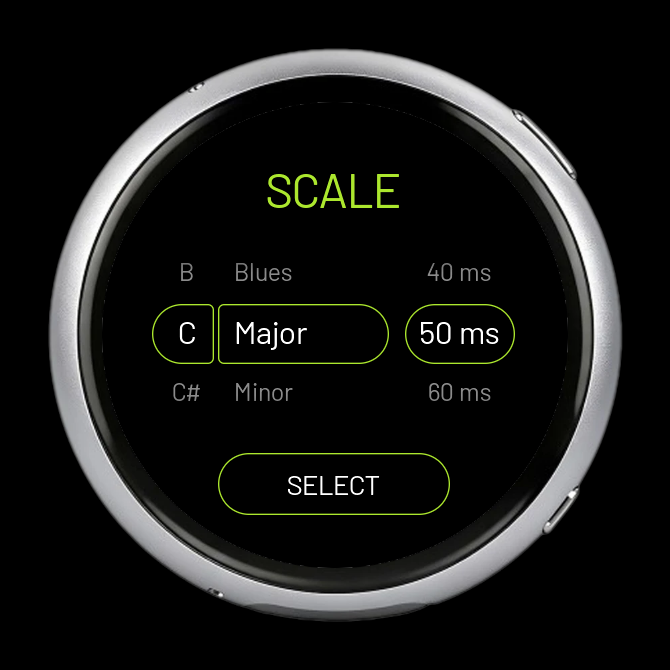
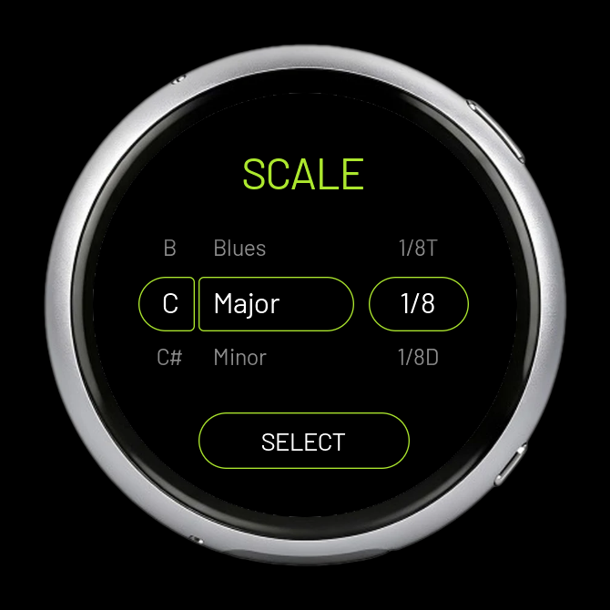

## 4. Keyboard — explore melodies

Every ring button represents **one note of the chosen scale**. The root is at the top, followed by ascending notes clockwise. Pentatonic scales have five buttons, Blues six, and seven-note scales seven.

Touch and hold a note, then release it to stop. Drag around the ring to play consecutive notes. **Two fingers can hold two notes at once.**

Double-tap the center to choose key and mode using two independent wheels. **SELECT or a short PWR press** saves the choice for all four modes with GLOBAL SCALE ON, or Keyboard only with it OFF.

The subtly rounded buttons have a distinctive outline: white at the outside, grading to the UI color toward the center. Resting button interiors stay black.

### Change octave

Start in the **empty center** and swipe up for a higher octave or down for a lower one. This gesture does not itself play a ring note.

The range is **0–8**, default **4**. A held note keeps its original pitch across an octave change; only new touches use the new register. You can keep a note held with one finger while swiping from the center with another.

A scale may extend above its starting octave. Notes outside MIDI's 0–127 range are hidden, leaving gaps rather than redistributing the remaining buttons. This project labels **MIDI note 60 as C4**; a DAW may use a different octave number for the same pitch.

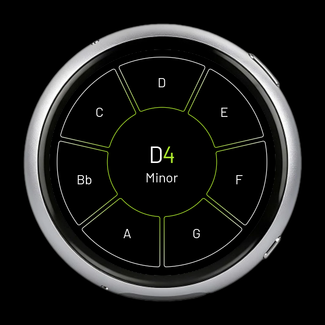
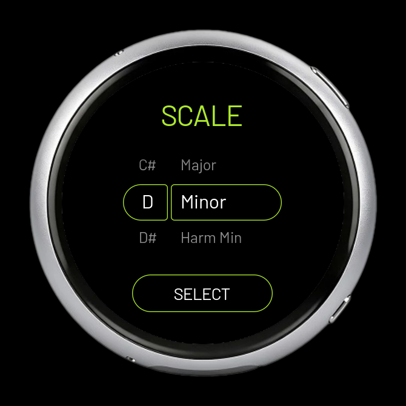

### Available scales

**Major, Natural Minor, Harmonic Minor, Melodic Minor** (ascending form), **Dorian, Phrygian, Lydian, Mixolydian, Locrian, Major Pentatonic, Minor Pentatonic and Blues**.

All twelve scales can be selected in all four modes. Chords always keeps seven buttons: **Major Pentatonic** uses the seven Major diatonic chords; **Minor Pentatonic** uses Natural Minor's chords. Their extra chord tones need not belong to the pentatonic melody. **Blues** is the minor blues scale, for example C–Eb–F–Gb–G–Bb. Its chord buttons also use Natural Minor: Cm–Ddim–Eb–Fm–Gm–Ab–Bb. Gb remains a melodic blue note.

The display uses international note names: **B is B natural, Bb is B flat**. Some German notation uses H for B natural. Sharps or flats are chosen to fit the key.

## 5. Arpeggiator — patterns from selected notes

Arpeggiator uses a narrower note ring to leave more room for its center settings.

**Tap ring buttons to toggle notes.** Selected degrees have outlines in the UI color; inactive ones are white. The currently played note also receives subtle fill feedback. Selected degrees across the chosen octave range form the pitch pool.

Without external clock, playback starts as soon as at least one note is selected. Deselect all notes to make it silent.

### Settings pages

Swipe sideways through the empty center. Pages loop in this order:

**SCALE → OCTAVES → PATTERN → DIVISOR → BPM → PROBABILITY → BLOCKSIZE → GATE → RATCHET → SWING → SCALE**.

The BPM page is hidden with **MIDI CLOCK ON**. Changes take effect directly; no SELECT button is needed.

| Page | Control and default |
|---|---|
| SCALE | Key and mode side by side. GLOBAL SCALE ON updates all four modes; OFF changes Arpeggiator only. |
| OCTAVES | First and last octave, inclusive. Range 0–8, default 3–5. Moving one boundary past the other moves the other along. |
| PATTERN | Pitch order; default UP. See the ten patterns below. |
| DIVISOR | 1/1, 1/2, 1/4, 1/8, 1/16 or 1/32 on the left; STRAIGHT, DOTTED or TRIPLET on the right. Default 1/8 STRAIGHT. |
| BPM | 40–300, default 120. Tap the TAP button in quarter notes. Hidden while clock reception is enabled. |
| PROBABILITY | 100–5% in 5% steps, default 100%. Chance that a note step is played. |
| BLOCKSIZE | OFF or 7, 6, 5, 4, 3, 2. Default OFF. Insert a rest after N note steps. |
| GATE | 100–5% in 5% steps, default 100%. Note duration as a share of step duration. |
| RATCHET | EVERY: OFF or 1–16 steps; COUNT: 2–4 total attacks. Default OFF / 2. |
| SWING | 0–50%, default 0. Alternate longer and shorter steps; 0 is straight timing. |

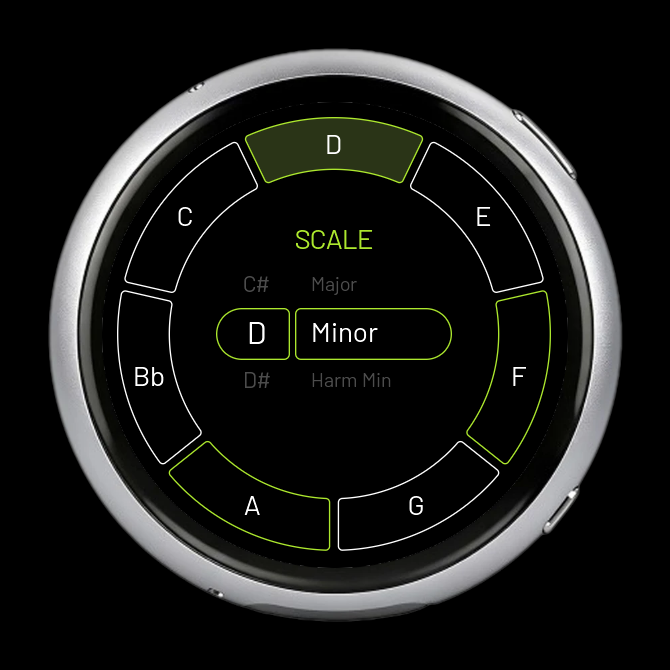
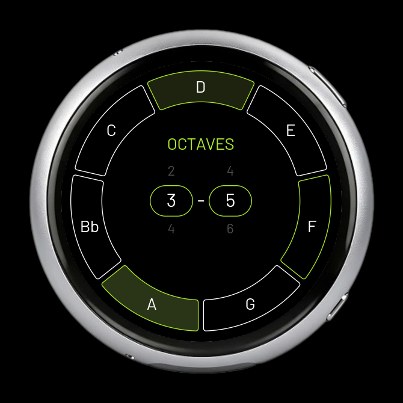

### Patterns

| Pattern | Pitch order |
|---|---|
| UP | Lowest to highest, then restart at the bottom. |
| DOWN | Highest to lowest. |
| UP/DOWN | Up and down without repeating the endpoints. |
| RANDOM | Random pitch from the pool; repeats are possible. |
| SHUFFLE | Play every pitch in shuffled order, then reshuffle. |
| CONVERGE | Lowest, highest, second-lowest, second-highest, continuing inward. |
| ANCHOR | Alternate the lowest pitch with a random other pitch. |
| LOW & HIGH | Lowest pitch, that same note in the highest selected octave, then a random other pitch. Repeat this three-step figure. |
| GRAVITY | Choose a random starting pitch from the third pool position upward, move approximately halfway downward, then play the lowest pitch: for example 6–3–1 or 7–4–1. |
| PIVOT | Gradually alter a pair: AB, AC, DC, DE, FE. After each pair, replace just one member, alternating which one changes. |

**ANCHOR tip:** Add or remove low notes while it runs. This changes the anchor and lets you weave melodic lines into the pattern.

In **LOW & HIGH**, HIGH is the anchor note in the highest selected octave, not the highest pitch in the entire pool. If LOW is C3 and HIGH C5, C4 remains eligible for the random step; only C3 and C5 are excluded. If no third pitch is available, that step is silent. LOW and HIGH coincide when only one octave is selected. A HIGH beyond MIDI's range is silent too.

With two pitches, GRAVITY repeats 2–1–1; with one, 1–1–1. PIVOT retains its pair with two pitches and repeats the only note with one. These patterns do not add fixed rests; use BLOCKSIZE and PROBABILITY for that. Old saved configurations containing the removed MIRROR or OCTAVE ECHO patterns load as UP.

Adding or removing notes and changing the octave range **do not reset the running sequence**. A pattern change applies at the next regular step boundary rather than cutting through the current note.

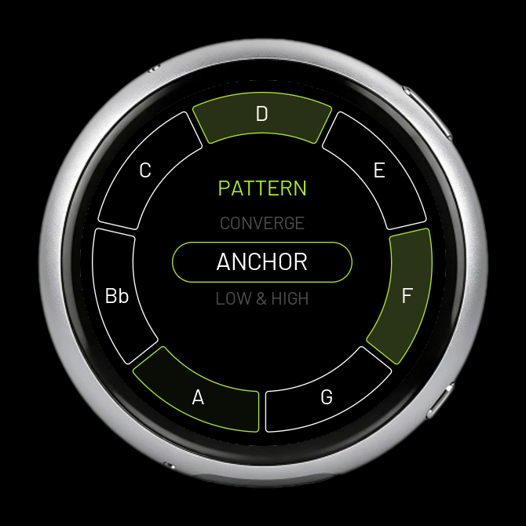
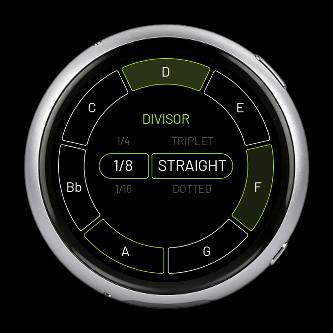

### Tempo, rests and swing

**TAP:** Tap several times at the desired quarter-note rate. Once a tempo is detected, the BPM wheel moves to it. Tapping changes tempo without restarting the pattern or cutting off the current note.

**Probability:** At 100%, every eligible step plays. Lower values create random gaps; 5% is the minimum. To silence the whole pattern, deselect all notes or change play mode.

**BLOCKSIZE:** A value of 2 gives `note – note – rest`; 4 gives `note – note – note – note – rest`. A rest lasts one step. The pitch pattern advances through rests too. Block counting follows grid positions; additional Probability skips do not shift it. Changing BLOCKSIZE restarts its count at the next regular step.

**Swing:** Average tempo stays the same while consecutive steps become long and short. At 120 BPM with 1/8, Swing 0 gives 250 ms for each step; Swing 50 gives 375 ms then 125 ms. The displayed 0–50 is the effect amount, not a conventional swing-ratio percentage.

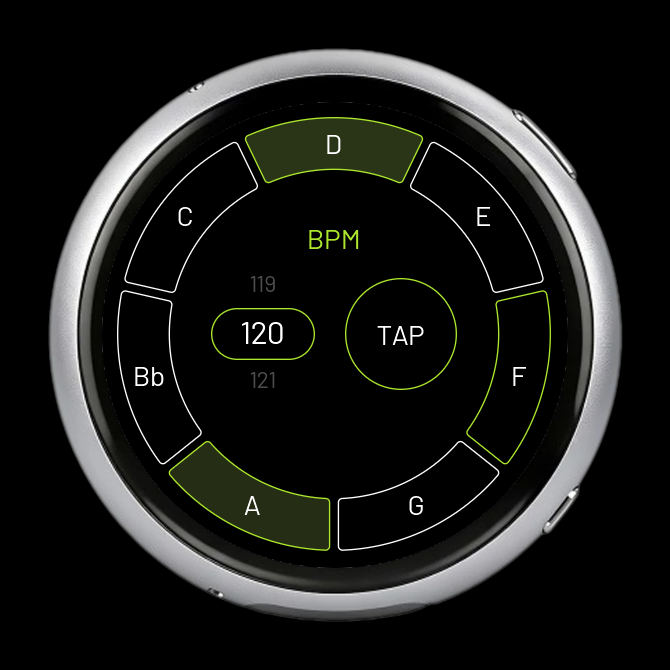
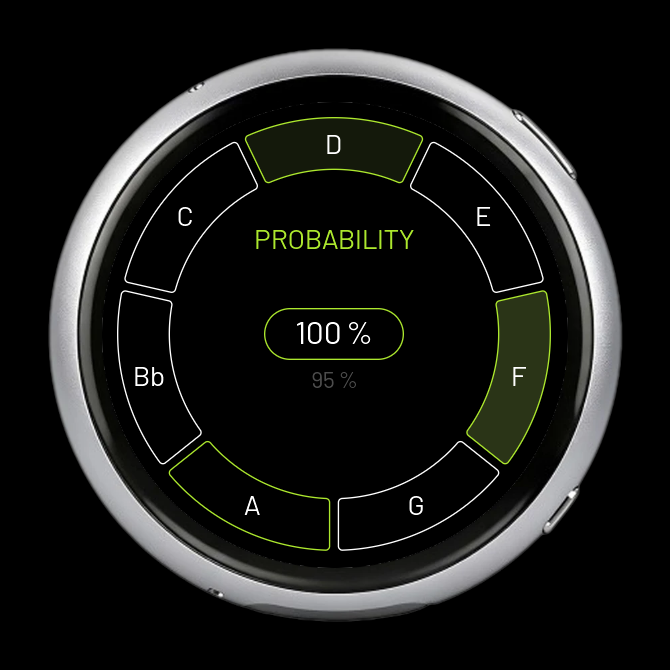

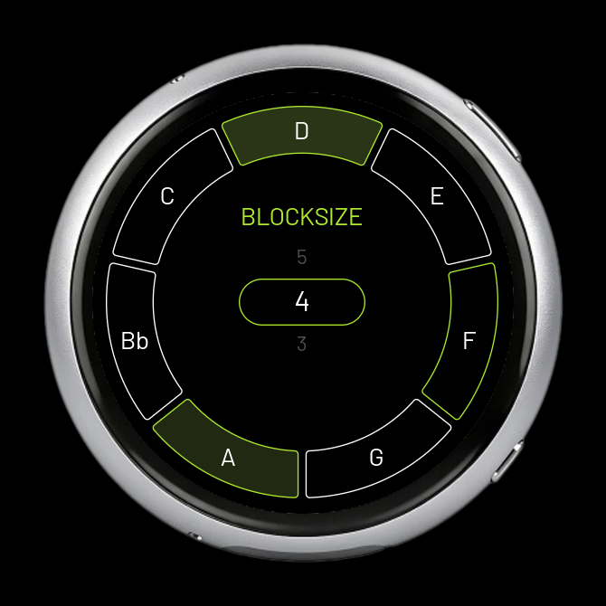
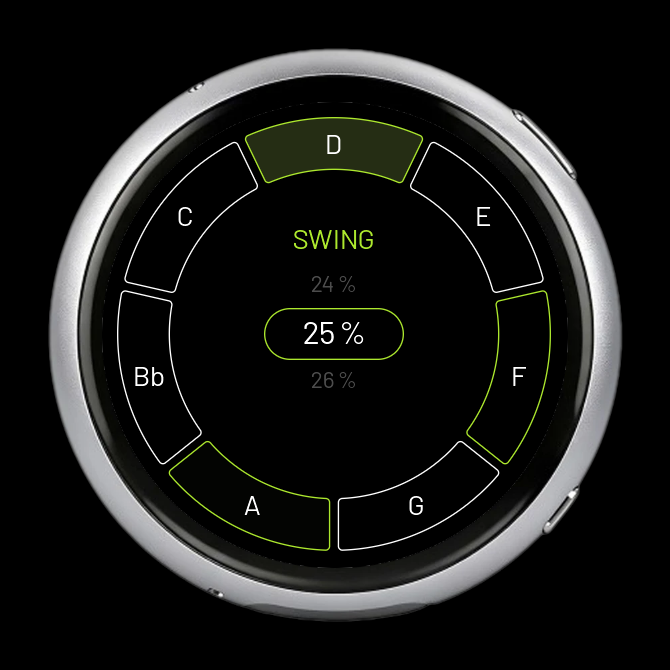

### Gate and ratchet

**GATE** controls how long a note is held within its step. At 120 BPM and straight 1/8, a step lasts 250 ms: Gate 100% holds until the next step; 50% holds for 125 ms. The instrument's release or the Travel synth's DECAY may remain audible afterward. Swing, dotted/triplet and external clock are included in step duration. A Gate change applies to the next note and does not cut the current one short.

**RATCHET** repeats the same pitch within a step. **EVERY 4 / COUNT 3** divides every fourth step into three equal attacks. The pitch pattern advances only at the next regular step. EVERY 1 affects every step; OFF disables ratcheting. BLOCKSIZE and Probability rests remain silent but count as grid positions.

Enabling Ratchet remembers the previous Gate value. If it exceeds 50%, Gate is automatically reduced to **50%** so repeated attacks remain distinct. Disabling Ratchet restores that remembered value. Changing EVERY, COUNT or GATE while Ratchet is already active does not replace the return value. Saving and loading includes it.

With Ratchet, Gate applies separately to each sub-attack. Long releases can blur the repeats together. Stop, mode changes and clock loss also cancel pending repeats.

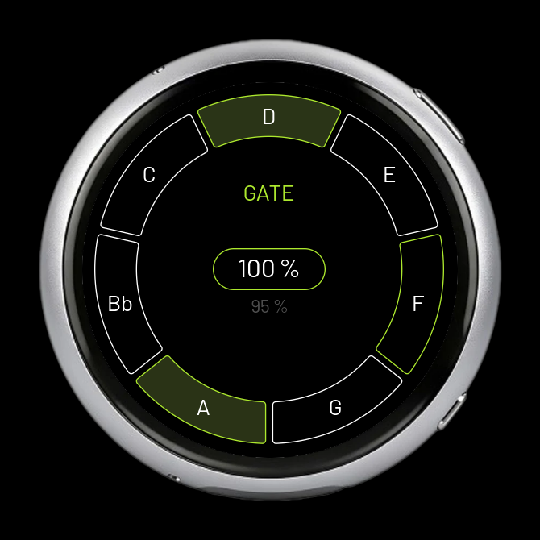
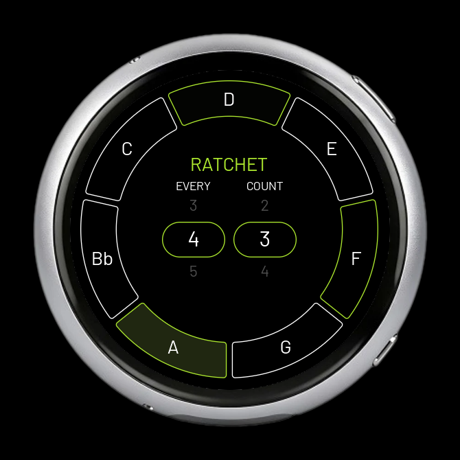

### External MIDI clock

In Setup, enable **MIDI → MIDI CLOCK** and confirm with a short PWR press. Choose Arpeggiator, select notes, then start the clock source.

- **MIDI Start:** restart the sequence.
- **MIDI Stop:** release the current note and stop; note selection remains.
- **MIDI Continue:** resume without requesting a full restart.
- Without clock for more than approximately 0.5 seconds, output stops. Send a new external Start to restart.

The MIDI Setup page shows measured clock BPM, or **-- BPM** before a valid measurement. Clock and transport do not depend on the MIDI note channel.

## 6. Kinetic — turn motion into music

Kinetic, previously called Bounce, is an interactive musical playground. Flick balls around the circular field; each hit on the outer note ring plays a note of the scale. Listen, pick up and relaunch a ball, or introduce another impulse.

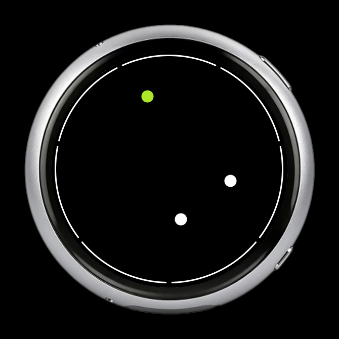
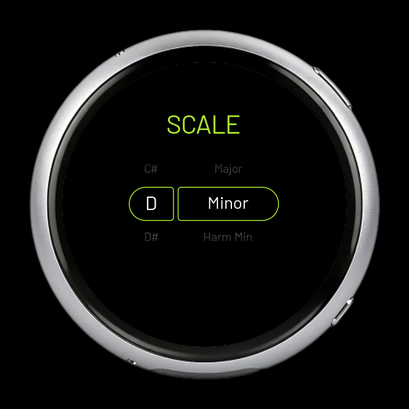

### Create, catch and throw balls

Touch an empty area, move your finger and release. A fast flick produces a fast ball; releasing after stopping does not add a new impulse. You can create **seven balls manually**.

Balls alternate between white and the UI color. They bounce off the boundary and each other. As energy decays, they shrink and slow down; their velocity curve spans **40–110**. Larger balls play lower octaves and smaller ones higher octaves within the selected range. At the end of their life they fade out over approximately 1.2 seconds.

Catch a ball to recharge it. Its energy and lifetime are reset; over approximately **120 ms**, it glides from its existing position to your finger and grows to full size at the same time. Even a fading ball can be caught. The pickup area stays generous for small balls; if several are nearby, the nearest available one is chosen. You can then throw it again. The selected throw response, curve 11, is fixed; the temporary curve-selection menu has been removed.

White boundary segments represent the scale's note regions. A hit briefly switches its segment to the UI color. The ring does not rotate. Seven-note scales have seven segments, pentatonics five and Blues six.

### Open settings

A **brief two-finger tap** opens the menu: touch with both fingers nearly simultaneously and release without swiping. In the simulator, **right-click** instead. Swipe sideways to cycle the pages. A short **PWR press** closes the menu; another changes to Keyboard. Balls and music continue while Kinetic's menu is open. Global Setup pauses this mode instead.

Changes take effect immediately and are saved automatically. There is no SELECT button. Firmware updates retain saved values; these defaults apply to a fresh configuration. Kinetic reset does not change them.

| Page | Control | Default |
|---|---|---|
| SCALE | Key and mode; GLOBAL SCALE ON synchronizes all four modes. | Shared scale; independent fallback B Minor. |
| OCTAVES | Lower and upper starting octaves, range 0–8. | 3–5 |
| BPM | 40–300 using wheel or TAP; hidden with MIDI CLOCK ON. | 120 |
| TIMING | QUANTIZE switch, divisor and STRAIGHT / DOTTED / TRIPLET. | ON, **1/8 STRAIGHT** |
| GATE | Note duration as a share of one step, 100–5% in 5% increments. | 50% |
| LIFETIME | Energy-decay time constant, 10–90 seconds in 5-second increments. | **15 s** |

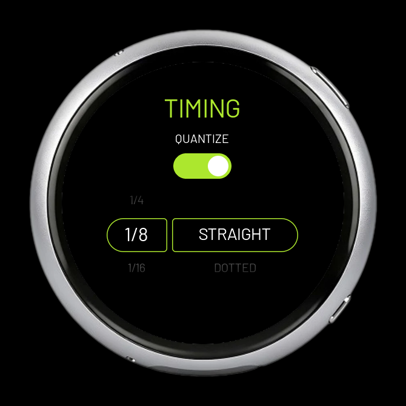
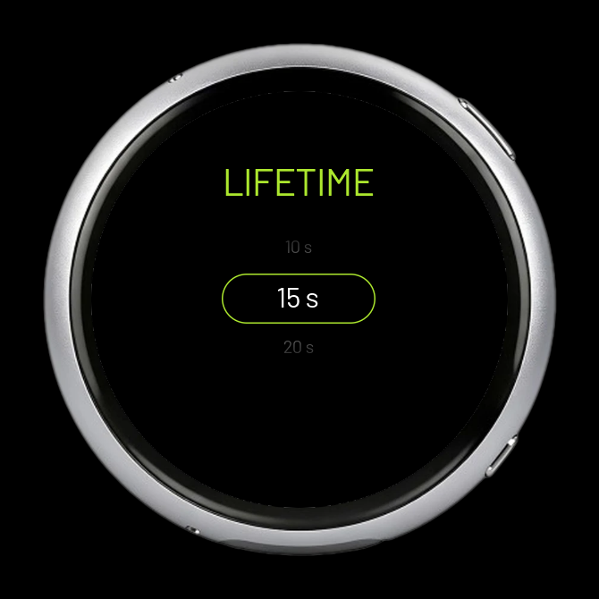

**LIFETIME is not a fixed stop timer.** It controls energy decay. An undisturbed ball normally remains visible longer than the displayed value. Catching it recharges it and changes its subsequent life.

### Grid, gate and chords

QUANTIZE ON collects boundary hits until the next selected grid point. At **120 BPM and 1/8 STRAIGHT**, a step lasts **250 ms**; Gate 50% holds a MIDI note for approximately **125 ms**, while 100% holds a full step. The receiving instrument's or Travel synth's release follows afterward. QUANTIZE OFF plays hits immediately; the chosen step length still determines Gate duration.

When different pitch classes land on the same grid point, Kinetic looks for a **major or minor triad from the active scale** close to the actual hits. Where register permits, it adds the root in another octave: four voices, not seventh chords. Identical pitch classes may stay as unisons or octaves. The result is therefore not always an unchanged replay of every individual hit.

With MIDI CLOCK ON and external transport running, the grid follows incoming clock. On Stop or clock loss, Kinetic continues on an internal grid using the last measured tempo, or saved BPM before its first measurement. Start/Continue with incoming clock restores external synchronization. You do not have to keep switching clock reception off and on. Pending hits are cleared when the time source changes; notes already sounding receive their normal Note Off.

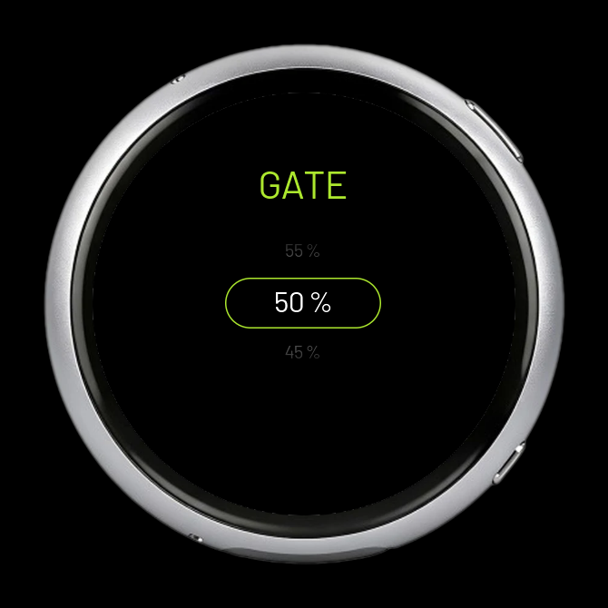

Ball collisions remain purely physical. Experimental ball splitting and its switch are removed in V1.0. Boundary hits generate the notes.

### Reset and persistence

On the unobstructed play screen, remove your fingers and hold the display face-down for **one second**. This clears all balls and queued notes, preserving every Kinetic setting. In the simulator, use **Reset at the top left** or **Ctrl + Shift + R**.

Kinetic saves settings as they change, but **not balls or their trajectories**. It starts empty after a restart. The eight LOAD / SAVE slots now include all Kinetic settings, but no live balls. Panning is not implemented; MIDI uses the global channel.

## 7. Setup and the Travel synth

**Hold PWR** to open Setup. Its pages cycle through **MIDI → MOTION CC → UI COLOR → TRAVEL MODE → GLOBAL SCALE → LOAD / SAVE → MIDI**. During a session, opening Setup returns to its last page. After restarting the device, it begins at MIDI.

You can edit several pages before confirming. **A new short PWR press saves all Setup values** and returns to the previous play mode.

### MIDI

The three top buttons choose **AUTO, USB or BLE**. AUTO is the default and prefers USB when a USB-MIDI connection is available. You may explicitly select BLE even with USB connected.

On the left, choose **CHANNEL 1–16**, default 1. On the right, **MIDI CLOCK** enables incoming external clock; default OFF. The channel applies to all modes. Keyboard, Chords and Arpeggiator use velocity 100; Kinetic uses 40–110 according to ball energy.

With MIDI CLOCK ON, measured tempo appears below: the number in white and **BPM** in the UI color. It needs a complete measurement and works outside Arpeggiator too. Missing or interrupted clock displays **-- BPM**.

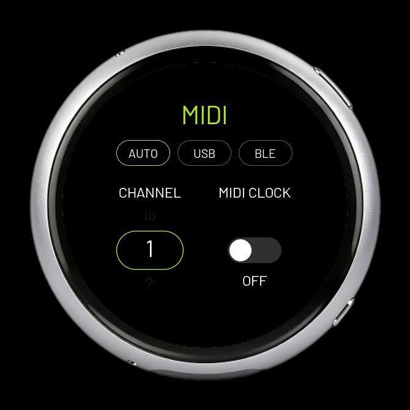
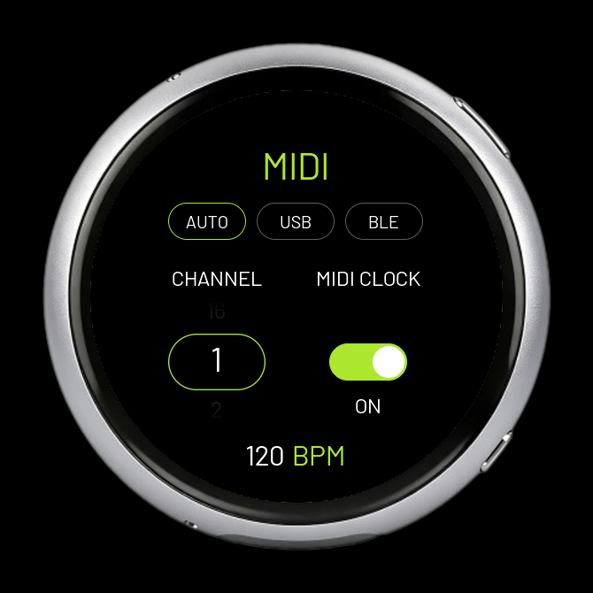

### MOTION CC — movement as modulation

This page is immediately after MIDI. Tilting the device controls two assignable MIDI controllers alongside the notes in **all four play modes**. **TRAVEL MODE must be OFF** for external MIDI output; the internal synth does not respond to these CCs.

| Setting | Function | Default |
|---|---|---|
| MIDI CHANNEL | Independent channel 1–16 for both motion axes, separate from the note channel. | 1 |
| X-AXIS | Tilt left/right; OFF or CC 1–119. X direction is inverted. | OFF |
| Y-AXIS | Tilt forward/back; OFF or CC 1–119. | OFF |
| CALIBRATE | Store the current comfortable playing position as the center. | Level reference |

All three wheels **wrap in both directions**. After CC 119, the axis wheels return to OFF; CC 1 is conventional modulation. The CC number selects a parameter at the receiving instrument; the transmitted CC value ranges from 0 to 127. CCs 120–127 are special channel commands and are not offered.

**To set it up:** disable TRAVEL MODE, assign one or both axes, select their MIDI CHANNEL, and hold the device still in your preferred playing position. Tap **CALIBRATE**. Success shows **CALIBRATED** with a subtle colored background; both text and background return to normal after three seconds. **Press PWR briefly to save and close** Setup. Assign the same channel and CC at your receiving instrument or MIDI-to-CV module.

The calibrated center sends **64**. Tilting **45° in either direction** reaches 0 or 127; farther movement is clamped. A **2° center dead zone** and smoothing reduce jitter. There is no live value display. Changes are sent at up to 25 updates per second per axis, with a periodic refresh of the current value.

Both axes can work together. Menus and invalid or stale sensor samples pause output. During play, modulation is independent of the played note and MIDI clock. **Channel, CC assignments and confirmed calibration survive shutdown**; LOAD / SAVE and face-down reset leave them unchanged. A previously saved experimental PITCH assignment becomes OFF: Pitch Bend is not included in this version.

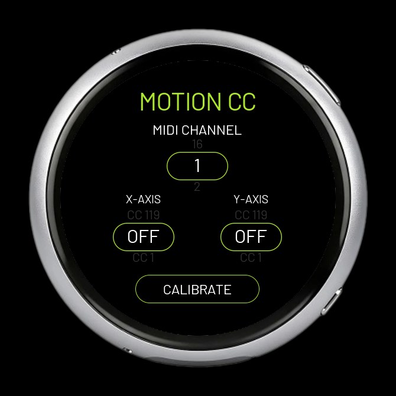
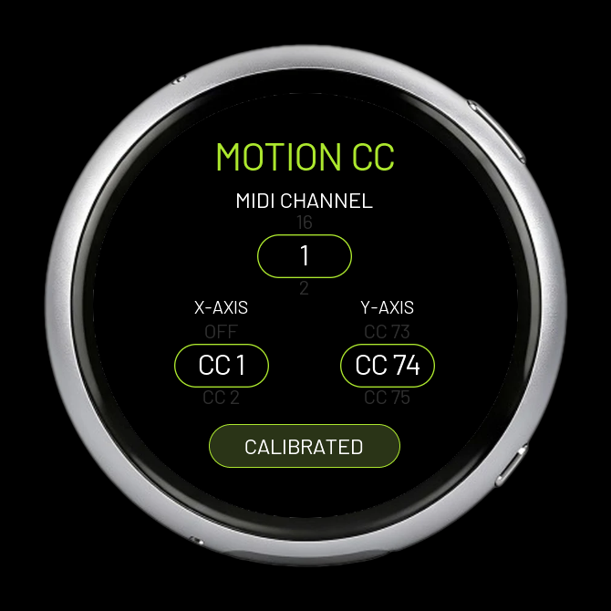

### UI COLOR

Drag the white handle around the color ring or tap the desired point. The current color appears in **UI COLOR** at the center and colors the interface accents. Note labels remain white. The default is lime green **#ACE72E**.

To change pages, start in the free center; a gesture starting on the color ring stays assigned to color selection. The confirmed color also applies to the boot logo and power-off ring.

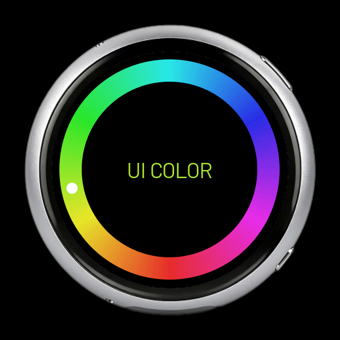

### TRAVEL MODE

**ON** plays the internal speaker synth and suppresses MIDI note output. **OFF** restores MIDI output. The Travel synth works without a computer and has **ten voices**.

| Setting | Choices |
|---|---|
| WAVEFORM | Saw, Square, Triangle, Pulse and Sine, shown as waveform symbols. |
| ATTACK | 0 / 5 / 10 / 20 / 50 / 100 / 200 / 500 / 1000 / 2000 ms. |
| DECAY | 10 / 25 / 50 / 100 / 200 / 400 / 800 / 1200 / 2000 / 4000 ms. |

Waveform selection wraps around. Attack and Decay stop at their minimum and maximum. Defaults: **Travel ON, Square, Attack 50 ms, Decay 400 ms**. DECAY is the release time here.

Attack sets the fade-in. A note sustains while held. **DECAY means fade-out after release here**—technically a release time. Sine is a soft sine-like waveform with subtle overtones; Pulse uses a different duty cycle from Square.

Ten voices can accommodate two complete ninth chords. If more voices are needed, an older one is replaced. Setup does not audition the synth separately: confirm, return to a play screen and listen there.

### GLOBAL SCALE

Default **ON** synchronizes key and scale across Chords, Arpeggiator, Kinetic and Keyboard. **OFF** lets each mode retain and edit its own selection.

- **ON → OFF:** All four modes start with the last shared scale, then become independent.
- **OFF → ON:** The scale of the play mode from which Setup was opened is copied to all four, replacing their separate selections.

Confirm with a new short PWR press. Only key and scale synchronize—not chord variants, strum, octave registers, Arpeggiator note selection or patterns.

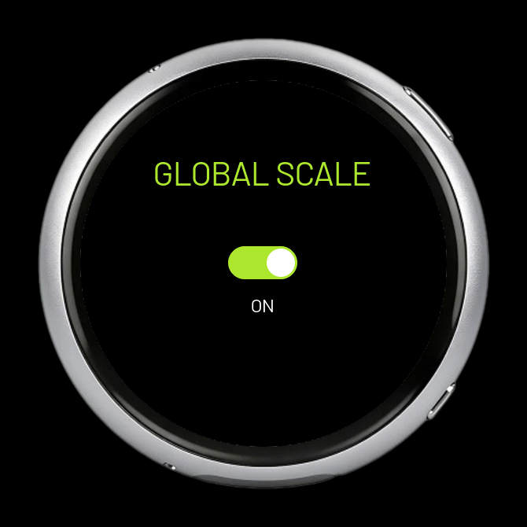
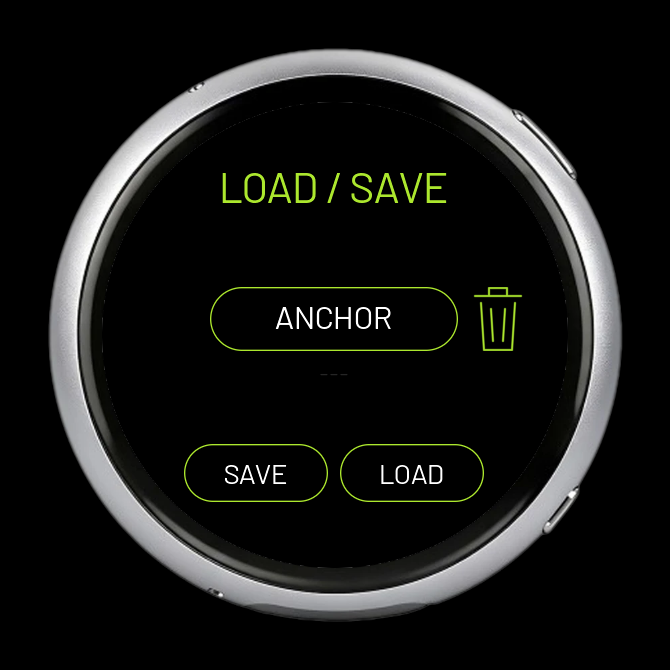

### LOAD / SAVE — store musical ideas

The central wheel selects one of **eight slots**. Occupied slots show their name; empty slots show **---**. A trash icon sits to the right. LOAD and the trash icon are dimmed for empty slots.

**Save:**

1. Select an empty or occupied slot and tap **SAVE**.
2. On the next screen, use eight independent endless character wheels to set a name. Characters cycle through space, A–Z, 0–9 and space again.
3. Empty slots start with blank characters. Overwriting an occupied slot starts from its current name.
4. Only **SAVE in the name editor** writes the musical snapshot. **CANCEL** returns without changing it.

Leading spaces are removed; spaces within the name remain. A completely blank name is allowed and also appears as **---**. Empty slots are collected at the end; a new idea occupies the first free slot.

**Load:** Select a slot, tap **LOAD**, check the name on the second screen, then tap **LOAD again**. CANCEL changes nothing.

**Delete:** Tap the trash icon and confirm **DELETE** on the second screen. CANCEL retains the slot. Later ideas move up after deletion, preserving their order.

Sideways page changes are disabled in these confirmation screens. **PWR does nothing, whether tapped or held.** Only the onscreen action button confirms, and only **CANCEL** dismisses the dialog. Back in the slot overview, a new short PWR press closes Setup.

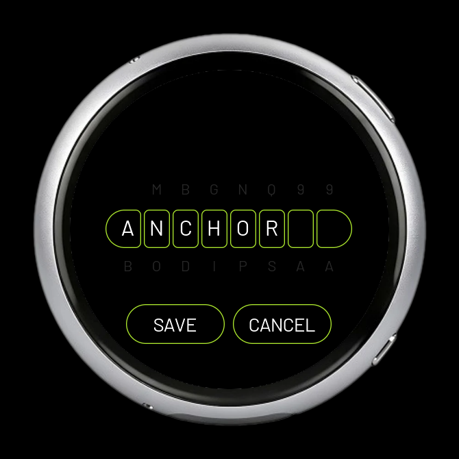
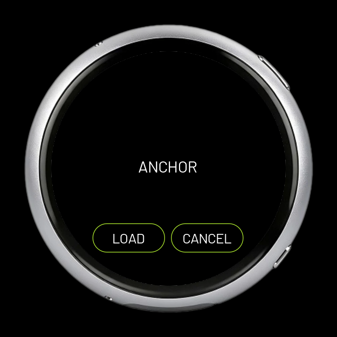

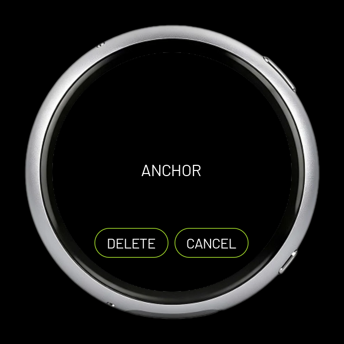
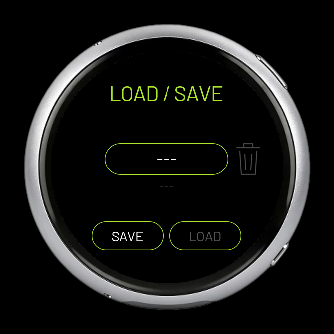

A slot contains:

- Chords, Arpeggiator, Kinetic and Keyboard keys/scales, plus **GLOBAL SCALE**.
- Keyboard octave.
- Every chord variant, octave shift and both strum settings.
- Arpeggiator octave range, pattern, divisor and rhythmic variant, BPM, Probability, BLOCKSIZE, GATE, Ratchet including its Gate return value, Swing, selected notes and last center page.
- Kinetic scale, octave range, BPM, divisor, timing modifier, quantization, Gate and Lifetime.

**Live Kinetic balls and their trajectories are not saved.** Older slots remain readable. Because they contain no Kinetic state, loading them uses the new Kinetic defaults, with the shared scale when GLOBAL SCALE is ON. Save the slot again to capture your desired Kinetic configuration.

**UI color, MIDI channel, MIDI CLOCK, Motion CC settings including calibration, and Travel synth settings remain global** and are not replaced by loading a slot. The current clock-reception setting takes precedence. Sounding notes are released before loading; old clock, transport and pattern positions are not replayed. After leaving Setup, an internal Arpeggio starts with the loaded note selection; externally clocked playback waits for Start/Continue.

Playing and editing later **does not overwrite your saved slots automatically**. Automatic preservation of the current working state is separate.

## 8. USB/BLE-MIDI and Ableton Live

The device provides **USB-MIDI** and **BLE-MIDI**. USB appears as **BAX:KI:ZL MIDI**, Bluetooth as **BAX:KI:ZL**. Both carry notes and receive MIDI clock.

**Tested routes:** The project initiator uses USB for Windows/Ableton and CME WIDI for wireless SmplTrek/Eurorack use. BLE note output back to Ableton showed uneven timing on his Windows setup even when incoming clock processing was stable. WIDI was stable in the same application. These are observations of that setup, not a guarantee for every PC or receiver. Android testing is still pending.

### USB connection to Windows/Ableton

Connect a USB data cable, start the instrument from its charging screen and select **USB** or **AUTO** in MIDI Setup. Enable **BAX:KI:ZL MIDI** in Ableton. AUTO prefers available USB-MIDI and switches to BLE when USB is disconnected. Send clock to whichever endpoint you actually use.

### BLE connection on Windows

The tested route uses **Windows MIDI Bluetooth Setup** and the separately installed Windows MIDI Services BLE-MIDI preview transport. For prerequisites and downloads, see the [official Microsoft guide](https://microsoft.github.io/MIDI/tools/midibluetoothsetup/).

1. Turn BAX:KI:ZL on and enable Bluetooth on the PC.
2. In **Windows MIDI Bluetooth Setup → Bluetooth devices**, find **BAX:KI:ZL** and choose **Connect**.
3. Select its MIDI input in your DAW. The setup application can then be closed.

**Bluetooth pairing alone is not enough:** Your music software also needs a usable MIDI endpoint. **MIDI READY** in the serial monitor indicates configured MIDI notifications. The device accepts one BLE central at a time.

### Play an Ableton instrument

1. Confirm **TRAVEL MODE OFF** on the device.
2. Open Live's **Link, Tempo & MIDI** or **Tempo & MIDI** settings.
3. For input **BAX:KI:ZL MIDI** (USB) or **BAX:KI:ZL** (BLE), choose **Track ON, Sync OFF, Remote OFF**.
4. Create a MIDI track with an instrument. Select that endpoint or All Ins and the correct channel or All Channels.
5. Use monitoring **In**, or **Auto** with the track armed. Play the device.

[Ableton's MIDI Settings guide](https://help.ableton.com/hc/en-us/articles/209774205-Live-s-MIDI-Settings) explains Track, Sync and Remote. Remote is unnecessary unless you deliberately create MIDI mappings.

### Use Ableton as the clock source

| Ableton port | Track | Sync | Remote |
|---|---|---|---|
| Input of the selected USB/BLE endpoint | ON | OFF | OFF |
| Output of the same endpoint | OFF | ON | OFF |

**Live remains the clock source; leave EXT OFF.** Confirm MIDI CLOCK ON at the device and Travel OFF when playing Ableton instruments. Prepare Arpeggiator, then start Live. Live supplies clock/transport; BAX:KI:ZL sends notes back. See [Ableton's MIDI synchronization manual](https://www.ableton.com/en/manual/synchronizing-with-link-tempo-follower-and-midi/).

Do not enable the controller's Sync input when Live should send clock. If you only play notes without clock, no Sync output is needed.

## 9. Shutdown and battery display

**Hold BOOT for three seconds.** The screen goes black, **POWER OFF** appears in white and the UI-colored ring drains away. Once empty, the device shuts down without USB or switches to its charging screen with USB attached.

Music and running patterns continue during the power-off/battery check. Release early to cancel and return to the previous screen. Only confirmed shutdown ends the output.

The battery under the text has a white outline and up to **five bars in the UI color**. It is a coarse charge indicator. **USB power** replaces the bars with a **lightning bolt**, even when full: during normal instrument operation, it indicates the power source rather than instantaneous charging current. Bars do not predict remaining playing time.

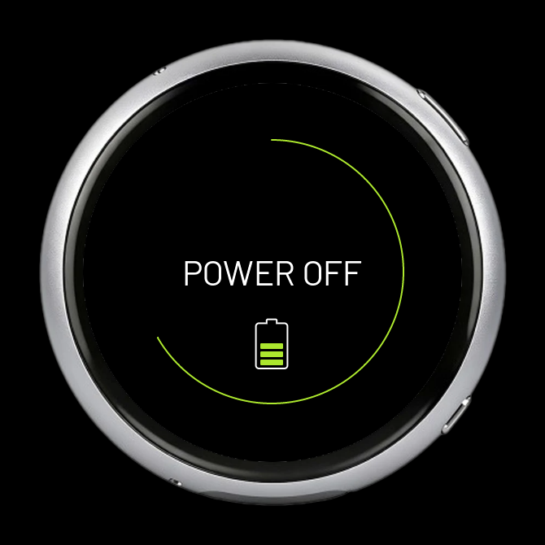
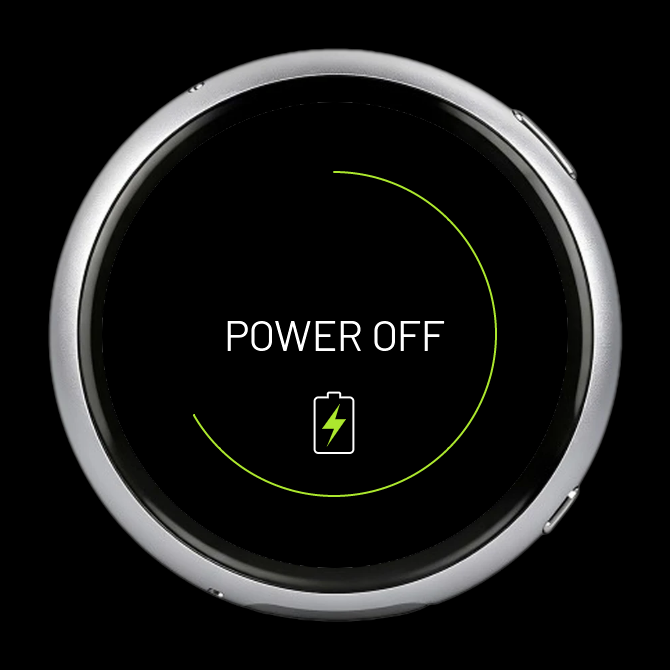

### Charging screen

Connecting USB to the powered-off device starts a **small battery centered on black**. The same view appears after powering off with USB attached. Connecting USB during normal playing does not take you out of the instrument.

The highest filled bar blinks every half second until charging completes. With an empty battery, the first bar blinks. At full charge, all five bars stay on; after **one minute of continuously confirmed full charge**, the device requests shutdown. Unplugging USB from this view also shuts it down. A **new PWR press** starts the instrument with its logo.

The charging screen plays no notes and starts no BLE connection. A question mark means unknown battery data; an X means no battery detected. Neither is treated as full charge.

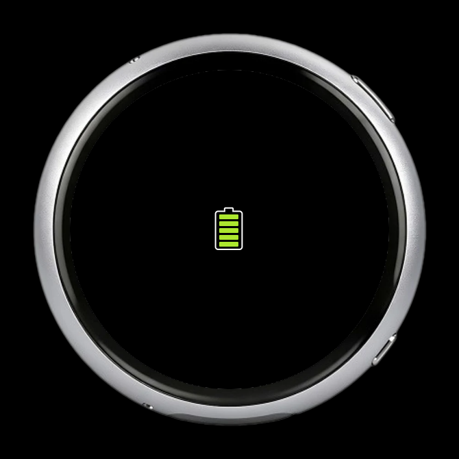

## 10. What is saved?

| Retained after power-off | Starts again after reboot |
|---|---|
| Keys/scales for all four modes and GLOBAL SCALE. | Play mode starts at Chords. |
| Every chord variant and octave shift; both strum selections. | Keyboard octave starts at 4 unless restored with LOAD. |
| All Arpeggiator settings, including BPM, Gate, Ratchet, selected notes and last center page. | Pattern position, sounding notes, tap timestamps and external clock measurement. |
| Kinetic scale, octaves, BPM, timing, quantization, Gate, Lifetime. | Kinetic starts empty; balls, active notes and trajectories are not stored. |
| Eight manually saved ideas and their names. | External transport waits for Start/Continue. |
| MIDI channel, MIDI CLOCK, UI color, Travel Mode, waveform, Attack and Decay. | Setup starts on the MIDI page. |

Scale selection and the Chord editor save with **SELECT or a short PWR press**. Global Setup confirms with a new short **PWR press**. SAVE, LOAD and DELETE require their own explicit confirmations. Arpeggiator changes are saved **automatically in the next UI cycle**, including selected notes, detected tap BPM and the center page. Only actual setting changes are written—not intermediate drag pixels, clock ticks or played notes.

Chords and Arpeggiator face-down resets are saved while key and scale remain. Kinetic only clears balls and preserves its settings. Arpeggiator can resume its working configuration after a restart, but its pattern starts fresh. With internal tempo and selected notes, entering that play mode starts it. Shutdown also checks for unsaved changes. Sudden power loss can lose the last change if its write has not completed.

## 11. Windows Companion and simulator

### Portable application

Run **BAX-KI-ZL-Companion.exe** from the current package. Its home screen has **Flash Firmware** and **Run Simulator**. The window stays square; the logo, text, buttons and spacing scale proportionally. UI text and error guidance are English. The EXE includes firmware, simulator, enclosure mask and runtime libraries. The Companion logo, button outlines and flash dialogs adopt the simulator?s confirmed UI color when returning home and on the next application start. Without a saved color, the default is lime green #ACE72E. The Waveshare retains its own color settings.

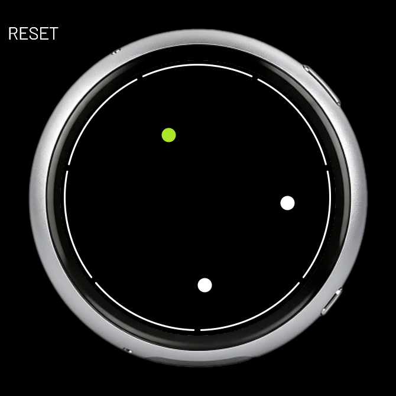

The EXE alone runs locally. For redistribution, use the **ZIP** with instructions, licenses and supplied sources. Close an already running Companion before opening a replacement version.

### Flash firmware

1. Connect the **Waveshare 1.75C, SKU 33691, 32 MB flash**, using a USB data cable. Close serial monitors.
2. Choose **Flash Firmware**. It searches for the BAX:KI:ZL CDC port or Espressif USB bootloader.
3. Check **Confirm flash port**. Multiple matches require an explicit selection. The ROM USB ID alone does not establish the board model.
4. Choose **Start Flash**. The package's files, target regions and checksums are validated. Bootloader port changes are tracked by USB location or serial number, then flashing starts directly, **without an automatic firmware backup**.
5. Watch the progress bar and log; keep USB connected. **Firmware flashed successfully** confirms writing and verification. A different COM number after restart is normal.

NVS settings and slots are not erased. Companion installs its **bundled release**; it does not download or compile firmware. A newer firmware release needs a newly built package. The application cannot be closed during flashing.

Failures display recovery instructions. **Scan Again** refreshes ports. **Open Logs** opens the user folder. For BOOT recovery: disconnect USB, hold BOOT, reconnect USB, then release BOOT. If battery power keeps the device on, hold BOOT during a restart. Confirm the new port and flash again.

### Simulator inside Companion

**Run Simulator** opens the complete simulation **inside the same window**. The clearly readable **RESET** text at the top left outside the bezel performs the face-down reset action. It appears only for modified chord buttons, resettable Arpeggiator values, or existing Kinetic balls. It is hidden in menus, Keyboard and empty or unchanged states. **Right-click** opens or closes Kinetic settings. There are no additional Back or two-finger buttons.

To return to Companion home, power off the simulated device normally: **hold the lower bezel button or B for three seconds**. Alternatively, close the whole application.

Companion uses **%LOCALAPPDATA%\BAX-KI-ZL**: `logs` contains flash and simulator logs; `simulator` holds its executable, mask, runtime libraries and settings. Existing backups are not deleted. The separate project command `Firmware.ps1 -Action Backup` remains available for an explicitly requested backup.

### Direct launch and inputs

In the project folder, **Starten.cmd** launches the simulator directly. No ESP32 is needed. The circular visible area represents the 466 × 466 display pixels; the enclosure is a mask and orientation aid.

Its physical size on your monitor also depends on screen resolution and Windows scaling. It is not automatically a true-size reproduction of the 1.75-inch display.

| Mouse or key | Device equivalent |
|---|---|
| Hold/drag left mouse button | First touch contact and gestures. |
| Hold right mouse button | Second retained contact in Chords/Keyboard; right-click opens/closes Kinetic settings. |
| Mouse wheel over a selector | Change that wheel's value. |
| Upper bezel button or P | PWR: short and long presses behave like the device. |
| Lower bezel button or B | BOOT: hold three seconds to exit the simulator after its countdown. |
| + / − | Raise/lower Keyboard octave. |
| Esc | Discard an open Setup or selection screen. |
| Ctrl + arrow keys | Adjust virtual tilt by 3° to test Motion CC in the simulator. |
| Ctrl + Home | Return the virtual device to a level pose. |
| Ctrl + Shift + R | Trigger the current Chords/Arpeggiator/Kinetic reset action, without simulating the actual motion detector. |
| RESET at the top left | The same reset action; visible only when something can actually be reset outside a menu. |

Travel Mode has local audio output. Simulator MIDI is currently a **console preview**, not a BLE connection to Ableton. UI and musical logic are shared with the device; sensor, power and radio behavior require hardware testing.

## 12. Troubleshooting

| Symptom | First checks |
|---|---|
| No speaker sound | Travel Mode ON? Confirmed Setup with a new short PWR press? |
| No motion modulation | Travel OFF, axis enabled, correct independent MIDI channel, receiver CC assignment and confirmed calibration? |
| No MIDI in Ableton | Travel OFF, usable USB/BLE MIDI endpoint, Track input enabled, correct channel, instrument and track monitoring? |
| Arpeggiator silent | Any notes selected? External clock enabled but transport not started? Allow several steps with low Probability. |
| Arpeggiator gaps | Check Probability, BLOCKSIZE and pattern choices. Very high octaves can exceed MIDI's pitch range. |
| Settings different after reboot | Confirmed selections with SELECT/PWR? Arpeggiator saves automatically, but pattern position and clock measurement start again. |
| Ratchet barely audible | Check Gate and the sound source's release. Long DECAY can merge repeats. |
| Only a battery appears after USB connection | This is the charging screen. Press PWR again to start the instrument. |
| Page swipe ignored | Start in a free area rather than on a wheel, note button or color ring. |
| Face-down reset ignored | Chords, Arpeggiator or Kinetic active? No touches, open menus or held PWR? Turn upright clearly, then hold face-down for one second within about 40 degrees of horizontal. |
| Old BLE name displayed | Disconnect/reconnect. If needed, remove the old Windows Bluetooth entry, reconnect, then reopen Ableton. |
| Flash port busy | Close its serial monitor or other COM applications; rescan and confirm the current port. |

Connection resets and menu transitions may release notes or require resting fingers to lift before new input is accepted. Release and touch again.

### Edition and limits

This manual describes the **firmware V1.1, source/build state of 11/07/2026**. Images come from isolated simulator captures using the default accent; personal settings and slots are not changed.

The project initiator has tested playing, Travel synth, USB-MIDI, WIDI, Kinetic (including earlier experiments with up to twelve balls), two-finger playing and Ableton clock on the hardware. Automated tests supplement these observations, not a complete hardware validation. Reported immediate response is not a measured latency figure.

Companion has automated UI, file, flash-workflow and Windows embedding tests. This manual does not claim a successful physical flash through the new Companion interface. A speaker click during the hardware reset used for flashing cannot be ruled out and has been accepted as a limitation.

Not yet included: pitchbend, a custom ESP-NOW/DIN bridge, Hum-to-MIDI or automatic key changes. CME WIDI serves as an off-the-shelf BLE/DIN receiver. This manual does not promise those future features.

Developer build instructions are in the source project's `README.md` and `firmware/README.md`. Additional technical documents are in `docs`; some are German.
